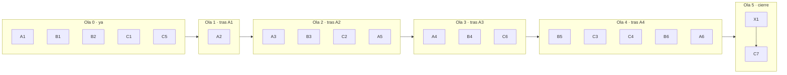

# Agentes y delegación

Cómo se reparte el trabajo de implementación entre personas y asistentes de IA. Esta fase termina con las fichas listas para despachar; nadie las ha ejecutado todavía.

## 1. Piezas

| Pieza | Para qué |
| --- | --- |
| [agentes/BACKLOG.md](agentes/BACKLOG.md) | Lista de tareas P0, P1 y P2 con orden y dependencias |
| [agentes/tareas/](agentes/tareas/) | Una ficha por tarea, lista para entregar a un agente |
| [agentes/PLANTILLA-TAREA.md](agentes/PLANTILLA-TAREA.md) | Molde para tareas nuevas |
| [agentes/prompts/](agentes/prompts/) | Un prompt autocontenido por perfil |
| [agentes/REGLAS-DE-TRABAJO.md](agentes/REGLAS-DE-TRABAJO.md) | Lo que todo agente debe respetar |
| [agentes/PROTOCOLO-INTEGRACION.md](agentes/PROTOCOLO-INTEGRACION.md) | Ramas, revisiones, conflictos y puntos de integración |

## 2. Perfiles y responsables

Un perfil es un tipo de trabajo. Una persona supervisa más de uno.

| Perfil | Prompt | Supervisa | Carpetas |
| --- | --- | --- | --- |
| Motor | [prompts/motor.md](agentes/prompts/motor.md) | A | `src/core/`, `src/app/`, `tests/core/` |
| Jugabilidad | [prompts/jugabilidad.md](agentes/prompts/jugabilidad.md) | B | `src/map/`, `src/data/content/`, `src/data/balance/` |
| Ciencia y datos | [prompts/ciencia-y-datos.md](agentes/prompts/ciencia-y-datos.md) | B | `src/data/nasa/`, tarjetas, `docs/CIENCIA-Y-DATOS.md` |
| Interfaz | [prompts/interfaz.md](agentes/prompts/interfaz.md) | C | `src/ui/`, `src/styles/` |
| Arte y audio | [prompts/arte-y-audio.md](agentes/prompts/arte-y-audio.md) | C | `public/assets/`, `src/audio/` |
| Integración y QA | [prompts/integracion-y-qa.md](agentes/prompts/integracion-y-qa.md) | A, con B y C | `tests/`, publicación |

## 3. Orden de despacho



Dentro de una ola las tareas son independientes y pueden ir en paralelo. Las dependencias exactas están en cada ficha y en el diagrama de [PLAN-EQUIPO.md](PLAN-EQUIPO.md#4-tablero-y-dependencias).

**Regla de contratos.** Si dos tareas necesitan un cambio en `src/core/types.ts` o en la API del núcleo, A hace ese cambio primero, en `main`, y después se despachan las tareas en paralelo.

## 4. Cómo despachar una tarea

1. Comprueba que las dependencias de la ficha están en `main`.
2. Crea la rama que indica la ficha, o un árbol de trabajo aparte si vas a lanzar varios agentes en la misma máquina (ver el protocolo).
3. Entrega al agente, en este orden: el prompt del perfil y la ficha de la tarea. Con Claude Code basta:

```text
Lee docs/agentes/prompts/<perfil>.md y ejecuta la tarea docs/agentes/tareas/<ficha>.md.
```

4. Revisa el informe del agente: archivos modificados, pruebas ejecutadas, resultados y pendientes.
5. Ejecuta tú las pruebas y abre el juego. El informe de un agente no sustituye a la comprobación.
6. Pide revisión al revisor de la ficha e integra según el protocolo.

## 5. Qué debe hacer todo agente

Resumen de [agentes/REGLAS-DE-TRABAJO.md](agentes/REGLAS-DE-TRABAJO.md):

- Consultar las fichas canónicas antes de escribir.
- Tocar solo las rutas permitidas y conservar el trabajo ajeno.
- Justificar cualquier dependencia nueva y esperar el visto bueno de A.
- Elevar a la persona responsable todo cambio de arquitectura, contrato o regla científica.
- Informar distinguiendo lo implementado, lo probado y lo pendiente.
- Conservar créditos, licencias y procedencia de recursos y cifras.

## 6. Subagentes nativos de Claude Code

Si el equipo quiere agentes con nombre dentro de Claude Code, cada perfil se convierte en un archivo de `.claude/agents/`. Ejemplo para el perfil de motor:

```markdown
---
name: motor
description: Implementa y prueba el núcleo de simulación de Earth's Angel en src/core y src/app. Úsalo para tareas T-*-A*.
model: sonnet
isolation: worktree
---

(pega aquí el contenido de docs/agentes/prompts/motor.md)
```

- `name` y `description` son obligatorios. La descripción decide cuándo Claude Code elige ese agente.
- `model` es opcional. Según la documentación consultada por el equipo, en la API de Anthropic `sonnet` y `haiku` seleccionan Claude Sonnet 5.5 y Claude Haiku 5.5. Comprueba qué versión ofrece tu cuenta.
- `isolation: worktree` da al agente su propia copia de trabajo de Git. Conviene cuando varios agentes escriben a la vez.
- Reserva los modelos de mayor capacidad para decisiones de arquitectura e integración (perfiles de motor e integración). Para datos, textos y estilos basta un modelo más ligero.

**Antes de usarlo, comprueba los campos en la documentación oficial:** [subagentes personalizados](https://code.claude.com/docs/en/sub-agents) y [alias de modelos](https://code.claude.com/docs/en/model-config#model-aliases). La CLI instalada en la máquina de planificación era la 2.1.291; el prompt maestro indica que Claude Fable 5.2 necesita la 2.1.321 o posterior, así que conviene ejecutar `claude update`.

Crear estos archivos es una decisión del equipo. No se han creado en esta fase.

## 7. Asistentes externos

Para Grok, GPT u otra herramienta: copia el prompt del perfil y la ficha de la tarea completos, más las secciones de [ARQUITECTURA.md](ARQUITECTURA.md) que la ficha cita. Verifica en esa herramienta la disponibilidad del modelo. Anota la herramienta y el modelo en [IA-Y-CREDITOS.md](IA-Y-CREDITOS.md).

## 8. Fichas

- P0: [agentes/tareas/](agentes/tareas/), una por tarea. Índice en el [backlog](agentes/BACKLOG.md).
- P1: [agentes/tareas/P1-campana-principal.md](agentes/tareas/P1-campana-principal.md)
- P2: [agentes/tareas/P2-segunda-oportunidad.md](agentes/tareas/P2-segunda-oportunidad.md)
