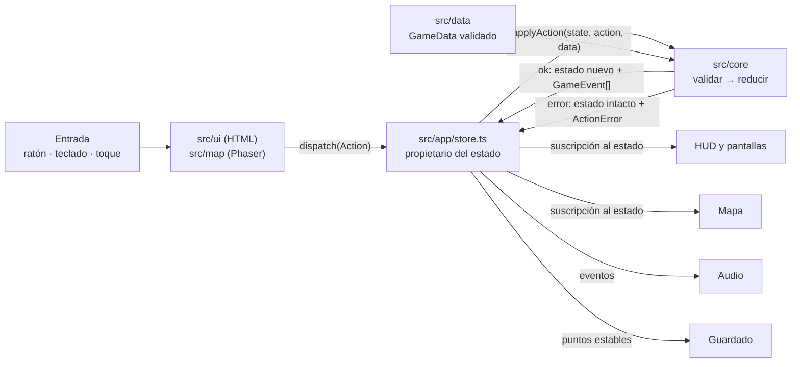
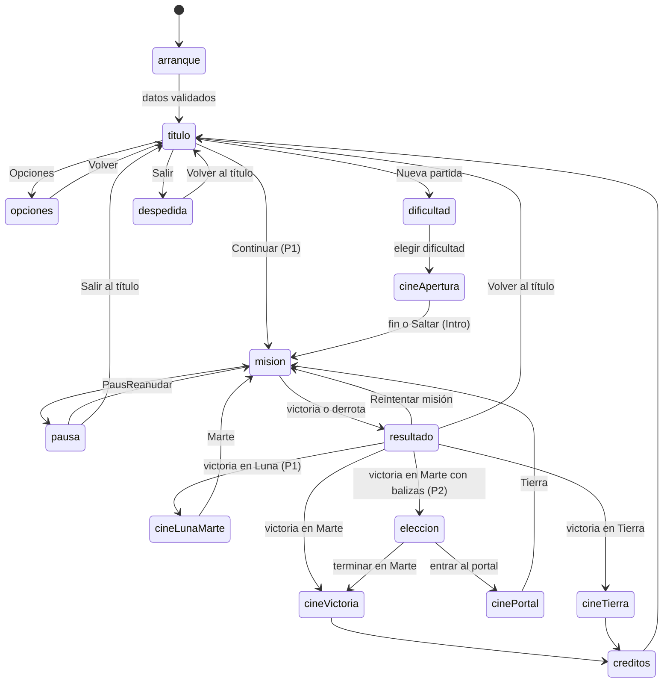

# Arquitectura · Earth's Angel

Este documento es la **fuente canónica de los contratos compartidos**: tipos, acciones, eventos, API del núcleo y máquina de estados. Si otro documento contradice a este, manda este. Solo A modifica los contratos (ver [agentes/PROTOCOLO-INTEGRACION.md](agentes/PROTOCOLO-INTEGRACION.md)).

> **Estado real (14-nov-2026).** La campaña se ejecuta con TypeScript 5.9.3 y Vite. El mapa usa Canvas y controles DOM. Los contratos integrados al final del documento actualizan los ejemplos de planificación.

## 1. Stack

| Pieza | Versión propuesta | Verificación (14-nov-2026) | Motivo |
| --- | --- | --- | --- |
| Node.js | 24.x | Instalado en la máquina de planificación: v24.21.0, npm 11.19.0 | Vite 8 exige `^20.19.0 \|\| >=22.12.0` (dato del registro npm). |
| TypeScript | 7.0.2 | Existe en npm como `latest` | Tipado de contratos. Respaldo si `tsc --noEmit` falla con los tipos de Phaser: 6.0.3 o 5.9.3. |
| Vite | 8.3.8 | Existe en npm como `latest` | Servidor de desarrollo y compilación a sitio estático. |
| Phaser | **3.90.0** (fijada exacta) | Última 3.x en npm. `latest` es 4.2.1 | Mapa 2D. Se elige la rama 3 por estabilidad, cantidad de ejemplos y porque los asistentes de IA la conocen mejor. |
| Vitest | 5.1.0 | Existe en npm como `latest`; acepta Vite `^6.4 \|\| ^7 \|\| ^8` | Pruebas del núcleo. |

**Por comprobar en [T-P0-A1](agentes/tareas/T-P0-A1-andamiaje.md):** que estas versiones instalan, compilan y prueban juntas. La compatibilidad conjunta no se ha ejecutado. Si algo falla, A fija la versión anterior estable y lo anota aquí.

No se añade ninguna otra dependencia de ejecución. Menús, HUD y cinemáticas son HTML y CSS propios. El audio usa la Web Audio API del navegador. Cualquier dependencia nueva necesita justificación escrita y el visto bueno de A.

**Salida:** sitio estático en `dist/`, sin servidor, sin claves, sin llamadas a API en tiempo real. Los datos van empaquetados.

## 2. Principios

1. **Un solo propietario del estado.** `src/app/store.ts` guarda el `GameState` autoritativo. Nadie más lo conserva ni lo modifica.
2. **Núcleo puro.** `src/core/` no importa DOM, Phaser, `localStorage`, `Date` ni `Math.random`. Recibe estado, acción y datos; devuelve estado nuevo, informe y eventos.
3. **La interfaz presenta, el mapa emite.** HUD, mapa y audio leen el estado y los eventos. Para cambiar algo, despachan una `Action`.
4. **Solo enteros.** Todas las cantidades son enteros. Las divisiones usan `Math.floor`. Así las pruebas no dependen de redondeos.
5. **Datos inyectados.** El núcleo recibe un `GameData` ya validado. Contenido, balance y datos NASA viven en archivos separados.
6. **Azar aislado.** Todo el azar se consume al crear la misión, con semilla. El resto del turno es determinista.
7. **Transiciones idempotentes.** El cambio de estado ocurre antes de la cinemática. Ver o saltar una escena solo navega.

## 3. Árbol de carpetas previsto y propietarios

```text
/
├─ index.html                     A   contenedor: #stage, #map, #ui
├─ package.json · tsconfig.json · vite.config.ts · .gitignore · LICENSE   A
├─ README.md (inglés) · CLAUDE.md · INTEGRANTE_*.md
├─ docs/                          documentación (este árbol)
├─ public/assets/                 C
│  ├─ sprites/  ui/  cinematics/  fonts/
│  └─ audio/music/  audio/sfx/
├─ src/
│  ├─ main.ts                     A   arranque y cableado
│  ├─ core/                       A   simulación pura
│  │  ├─ types.ts                     contratos (copia fiel de la sección 5)
│  │  ├─ rng.ts  mission.ts  actions.ts  day-cycle.ts  energy.ts  life-support.ts
│  │  ├─ water-food.ts  radiation.ts  crew.ts  objectives.ts  events.ts
│  │  ├─ progression.ts  validate.ts  save.ts  fixtures.ts  index.ts
│  ├─ app/                        A   servicios de aplicación
│  │  ├─ context.ts  store.ts  ui-store.ts  flow.ts  options.ts  persistence.ts
│  │  ├─ i18n.ts  input.ts  seed.ts  silent-audio.ts  debug.ts
│  ├─ data/                       B   datos empaquetados
│  │  ├─ content/   buildings.json  events.json  cards.json  tutorial.json
│  │  │             levels/luna.json  levels/marte.json  levels/tierra.json
│  │  ├─ balance/   constants.json  difficulty.json  luna.json  marte.json  tierra.json
│  │  ├─ nasa/      donki-sep.json  adapter.ts  (procedencia en CIENCIA-Y-DATOS.md)
│  │  ├─ i18n/      en/ui.json (C) · en/sim.json (A) · en/content.json (B)
│  │  │             es/ui.json (C) · es/sim.json (A) · es/content.json (B)
│  │  └─ index.ts  validate.ts        carga y valida → GameData
│  ├─ map/                        B   escena Phaser del tablero
│  │  ├─ index.ts  MapScene.ts  tiles.ts  map-input.ts
│  ├─ ui/                         C   pantallas y HUD en HTML
│  │  ├─ index.ts                     registerScreens
│  │  ├─ screens/   title.ts  difficulty.ts  options.ts  farewell.ts  cinematic.ts
│  │  │             mission.ts  pause.ts  result.ts  credits.ts
│  │  ├─ hud/       medidores, objetivos, pronóstico, paleta, tripulación
│  │  ├─ panels/    day-report.ts  science-card.ts  tutorial.ts  learning-check.ts
│  │  │             decision.ts (B)
│  │  ├─ components/  button.ts  slider.ts  toggle.ts  dialog.ts  status-badge.ts
│  │  ├─ cinematics/  player.ts  narrative.ts  scripts/*.json
│  │  └─ credits-data.ts
│  ├─ styles/                     C   index.css  tokens.css  base.css  hud.css  screens.css
│  └─ audio/                      C   index.ts  audio-manager.ts  manifest.ts  synth.ts
└─ tests/
   ├─ core/                       A   pruebas unitarias y vectores dorados
   ├─ data/                       B   validación de JSON y de procedencia
   └─ ui/                         C   opcionales
```

Cada carpeta tiene un propietario. Dos personas no editan el mismo archivo. Las dos excepciones están marcadas: `src/ui/panels/decision.ts` es de B y los catálogos de cadenas se reparten por espacio de nombres.

## 4. Flujo de datos



Paso a paso:

1. La interfaz o el mapa construyen una `Action` y llaman a `store.dispatch(action)`.
2. El almacén llama a `applyAction(state, action, data)`. El núcleo **valida primero**.
3. **Acción inválida:** el núcleo devuelve `{ ok: false, error }` y el estado no cambia. El inventario se conserva. El almacén emite `action/rejected` y la interfaz muestra `error.messageKey`.
4. **Acción válida:** el núcleo devuelve estado nuevo y eventos. El almacén reemplaza el estado, notifica a los suscriptores y reenvía los eventos.
5. **Entrada repetida:** `END_DAY`, `ACK_REPORT` y `DECIDE_SHELTER` llevan el `day` que el jugador veía. Si no coincide con `mission.day`, o la fase no es la esperada, la acción se rechaza con `STALE_DAY` o `WRONG_PHASE`. Una doble pulsación de **Finalizar día** avanza un solo día.
6. **Transición fallida:** `applyTransition` valida la precondición y es atómica. Si falla, devuelve error, el estado queda igual y el flujo permanece en la pantalla de resultado con la opción de reintentar. Si el estado resultante no supera `validateState`, se descarta.
7. En cada **punto estable** (sección 8) el servicio de persistencia guarda una instantánea.

## 5. Contratos TypeScript

Copia fiel prevista para `src/core/types.ts`. La columna de propietarios de cada campo está en la sección 6.

```ts
// ---------- Identificadores ----------
export type DifficultyId = 'facil' | 'media' | 'imposible';
export type LevelId = 'luna' | 'marte' | 'tierra';
export type ResourceId = 'energia' | 'oxigeno' | 'agua' | 'alimentos' | 'materiales';
export type Resources = Record<ResourceId, number>; // enteros >= 0

export type BuildingType =
  | 'nave' | 'panel' | 'bateria' | 'generador' | 'reciclador' | 'extractor'
  | 'invernadero' | 'refugio'                                   // P0
  | 'deposito' | 'comunicaciones' | 'laboratorio' | 'habitat';  // P1

export type Terrain = 'llano' | 'roca' | 'crater' | 'hielo' | 'mineral' | 'misterio' | 'nave';
export type RadiationLevel = 0 | 1 | 2; // 0 ninguna · 1 moderada · 2 severa
export type EventType = 'sombra' | 'tormenta-solar' | 'tormenta-polvo' | 'averia';
export type ObjectiveId =
  | 'soporte' | 'energia' | 'alimentos' | 'reservas' | 'proteccion' | 'racha'
  | 'comunicaciones' | 'autonomia'; // los dos últimos, Marte
export type MissionPhase = 'decision' | 'planning' | 'report' | 'ended';
export type DefeatCause = 'plazo' | 'soporte-vital' | 'exposicion' | 'escasez' | 'objetivos';

// ---------- Mundo ----------
export interface Tile {
  x: number; y: number;        // 0-based, origen arriba a la izquierda
  terrain: Terrain;
  explored: boolean;
  collected: boolean;          // solo tiene sentido en 'mineral'
}

export interface Building {
  id: number;
  type: BuildingType;
  x: number; y: number;
  placedDay: number;
  operationalFromDay: number;  // placedDay + buildDays
  enabled: boolean;            // interruptor del jugador
  growth: number;              // invernadero: días de cultivo acumulados
  stress: number;              // invernadero: días operativos sin funcionar
  damaged: boolean;            // P1
}

export interface CrewMember {
  id: number;
  nameKey: string;             // clave del catálogo, no un nombre real
  health: number;              // 0..100
  exposure: number;            // 0..100, unidades de juego
}

export interface ScheduledEvent {
  id: string;                  // p. ej. 'luna-sep-1'
  type: EventType;
  startDay: number;
  durationDays: number;
  solarFactorPct?: number;     // sombra y polvo
  radiationLevel?: RadiationLevel;
  sourceRef?: string;          // id del registro NASA, p. ej. '2017-09-10T16:25:00-SEP-001'
}

export interface ObjectiveStatus {
  id: ObjectiveId;
  met: boolean;
  current?: number;
  target?: number;
}

// ---------- Estado ----------
export interface MissionState {
  level: LevelId;
  day: number;                 // día o sol local, empieza en 1
  phase: MissionPhase;
  ap: number;                  // puntos de acción disponibles hoy
  apSpentToday: number;
  shelterToday: boolean;
  decisionPending: string | null;   // id del evento que exige decisión
  resources: Resources;
  caps: Resources;
  map: { width: number; height: number; tiles: Tile[] }; // fila por fila
  buildings: Building[];
  nextBuildingId: number;
  crew: CrewMember[];
  schedule: ScheduledEvent[];  // generado al crear la misión
  energyPriority: BuildingType[];
  wastewater: number;          // agua que bebió la tripulación el día anterior
  harvests: number;
  streak: number;
  objectives: ObjectiveStatus[];
  discoveries: string[];
  lastReport: DayReport | null;
  result: MissionResult | null;
}

export interface CampaignState {
  version: number;             // versión del esquema de estado
  seed: string;
  canonical: boolean;          // true: programa de eventos sin variación
  difficulty: DifficultyId;
  level: LevelId;
  earthDaysRemaining: number;  // plazo terrestre global
  appliedTransitions: string[];// p. ej. ['luna->marte']
  clues: string[];             // pistas de la ruta secreta
  narrativeFlags: Record<string, boolean>;
  manifest: TransferManifest | null;
  history: MissionResult[];
}

export interface GameState {
  campaign: CampaignState;
  mission: MissionState;
}

export interface TransferManifest {
  crew: CrewMember[];
  supplies: Resources;         // lo que viaja a Marte
  discoveries: string[];
  clues: string[];
  bonusDaysApplied: number;
}

// ---------- Acciones ----------
export type Action =
  | { type: 'BUILD'; building: BuildingType; x: number; y: number }
  | { type: 'EXPLORE'; x: number; y: number }
  | { type: 'COLLECT'; x: number; y: number }
  | { type: 'TOGGLE_BUILDING'; buildingId: number; enabled: boolean }
  | { type: 'SET_ENERGY_PRIORITY'; order: BuildingType[] }
  | { type: 'DECIDE_SHELTER'; shelter: boolean; day: number }
  | { type: 'END_DAY'; day: number }
  | { type: 'ACK_REPORT'; day: number }
  | { type: 'RESTART_MISSION' }
  | { type: 'REPAIR'; buildingId: number }      // P1
  | { type: 'CLEAN_PANELS' }                    // P1, Marte
  | { type: 'ACTIVATE_BEACONS' };               // P2

export type ActionErrorCode =
  | 'WRONG_PHASE' | 'STALE_DAY' | 'DECISION_PENDING'
  | 'NO_AP' | 'NO_MATERIALS'
  | 'TILE_OUT_OF_BOUNDS' | 'TILE_UNEXPLORED' | 'TILE_OCCUPIED' | 'TILE_BLOCKED' | 'WRONG_TERRAIN'
  | 'ALREADY_EXPLORED' | 'NOT_ADJACENT' | 'NOTHING_TO_COLLECT'
  | 'UNKNOWN_BUILDING' | 'NOT_AVAILABLE_IN_LEVEL'
  | 'NO_SHELTER' | 'NO_ENERGY_FOR_SHELTER' | 'NO_RADIATION_TODAY'
  | 'INVALID_PRIORITY';

export interface ActionError {
  code: ActionErrorCode;
  messageKey: string;                          // p. ej. 'sim.error.NO_MATERIALS'
  params?: Record<string, string | number>;
}

export type ActionResult =
  | { ok: true; state: GameState; events: GameEvent[] }
  | { ok: false; state: GameState; error: ActionError }; // state es el mismo objeto de entrada

// ---------- Informe del día y resultado ----------
export interface DayReport {
  day: number;
  level: LevelId;
  activeEvents: { id: string; type: EventType; sourceRef?: string }[];
  solarFactorPct: number;
  radiationLevel: RadiationLevel;
  energy: {
    start: number; generated: number; used: number;
    end: number; cap: number; wasted: number;
    unpowered: number[];                       // ids de edificios sin electricidad
  };
  produced: { agua: number; oxigeno: number; alimentos: number };
  moduleInputs: { agua: number };              // agua usada por generador e invernadero
  crewConsumed: { oxigeno: number; agua: number; alimentos: number };
  shortages: { oxigeno: number; agua: number; alimentos: number }; // tripulantes sin ración
  wasted: Partial<Resources>;                  // lo que no cupo en el almacén
  crew: {
    id: number; health: number; healthDelta: number;
    exposure: number; exposureDelta: number; sheltered: boolean;
  }[];
  shelter: { requested: boolean; active: boolean };
  stable: boolean;
  streak: number;
  objectives: ObjectiveStatus[];
  causeEffectKeys: string[];                   // claves de explicación causa-efecto
  result: MissionResult | null;
}

export interface MissionResult {
  outcome: 'victory' | 'defeat';
  cause?: DefeatCause;
  level: LevelId;
  difficulty: DifficultyId;
  seed: string;
  daysUsed: number;
  earthDaysRemaining: number;
  resources: Resources;
  margins: { oxigeno: number; agua: number; alimentos: number; energia: number }; // reserva - umbral
  maxExposure: number;
  incidents: string[];                         // claves de incidentes
  principleKey: string;                        // principio científico
  suggestionKey: string;                       // sugerencia para el siguiente intento
}

export interface ForecastItem {
  eventId: string; type: EventType; inDays: number;   // 0 = hoy
  durationDays: number;
  solarFactorPct?: number; radiationLevel?: RadiationLevel; sourceRef?: string;
}

// ---------- Configuración ----------
export interface BuildingDef {
  type: BuildingType;
  cost: number; apCost: number; buildDays: number;
  energyPerDay: number;
  requiresTerrain: Terrain;                    // 'llano' salvo el extractor: 'hielo'
  levels: LevelId[];
  priority: number;                            // orden por defecto, menor = antes
  capacity?: number;                           // refugio: plazas · batería y depósito: capacidad
  nameKey: string; descKey: string; whyKey: string; cardId?: string;
}

export interface DifficultyConfig {            // por dificultad y nivel
  crewSize: number;
  dayLimit: number | null;                     // ventana local; null = solo plazo terrestre
  initial: Resources;
  mineralYield: number;
  reserveThreshold: number;                    // oxígeno, agua y alimentos
  energyThreshold: number;
  streakDays: number;
  shelterEnergy: number;
  events: { type: EventType; startDay: number; durationDays: number;
            solarFactorPct?: number; radiationLevel?: RadiationLevel; jitterDays?: number }[];
}

export interface LevelConfig {
  id: LevelId;
  width: number; height: number;
  rows: string[];                              // un carácter por casilla, ver niveles/*.md
  ship: { x: number; y: number };
  initialExploredRadius: number;
  baseCaps: Resources;
  availableBuildings: BuildingType[];
  objectives: ObjectiveId[];
  forecastHorizonDays: number;
}

export interface GameData {
  buildings: Record<BuildingType, BuildingDef>;
  levels: Record<LevelId, LevelConfig>;
  difficulty: Record<DifficultyId, { earthDays: number; bonusDays: number;
                                     levels: Record<LevelId, DifficultyConfig> }>;
  constants: SimConstants;                     // ver dificultad-y-balance.md
  nasa: { sep: NasaSepRecord[] };              // ver adaptador-datos-nasa.md
}

// ---------- Guardado ----------
export interface SaveData {
  schema: 'earths-angel/save';
  version: number;
  savedAtDay: number;                          // día de juego, no reloj real
  state: GameState;
}
```

`SimConstants` y `NasaSepRecord` se definen en [componentes/dificultad-y-balance.md](componentes/dificultad-y-balance.md) y [componentes/adaptador-datos-nasa.md](componentes/adaptador-datos-nasa.md).

## 6. Quién modifica cada campo

Solo funciones de `src/core/` escriben en el estado. La tabla indica cuál.

| Campo | Lo escribe | Cuándo |
| --- | --- | --- |
| `campaign.seed`, `canonical`, `difficulty` | `createCampaign` | Una vez, al crear la partida. |
| `campaign.earthDaysRemaining` | `advanceDay` (−1 por día) · `applyTransition` (bono) | Al cerrar cada día. El bono, una vez. |
| `campaign.level`, `appliedTransitions`, `manifest` | `applyTransition` | En la transición de nivel. |
| `campaign.clues`, `narrativeFlags` | `actions.ts` (descubrimientos) · `progression.ts` | Al explorar una casilla `misterio` o cumplir un hito. |
| `campaign.history` | `advanceDay` | Al terminar una misión. |
| `mission.day`, `phase`, `lastReport`, `result` | `advanceDay` · `ACK_REPORT` · `DECIDE_SHELTER` | Cierre y apertura de día. |
| `mission.ap`, `apSpentToday`, `shelterToday`, `decisionPending` | `startDay` (interno) · acciones | Al abrir el día y al gastar puntos. |
| `mission.resources`, `caps` | `actions.ts` (materiales) · `advanceDay` (todo lo demás) | Construir y recolectar; cierre de día. |
| `mission.map.tiles[].explored`, `collected` | `EXPLORE`, `COLLECT` | Planificación. |
| `mission.buildings`, `nextBuildingId` | `BUILD`, `TOGGLE_BUILDING` · `advanceDay` (`growth`, `stress`) | Planificación y cierre de día. |
| `mission.crew[].health`, `exposure` | `advanceDay` | Cierre de día. |
| `mission.schedule` | `createMission` | Una vez por misión. |
| `mission.energyPriority` | `SET_ENERGY_PRIORITY` | Planificación. |
| `mission.wastewater`, `harvests`, `streak`, `objectives` | `advanceDay` | Cierre de día. |

Fuera del núcleo: `src/app/options.ts` es dueño de las opciones (idioma, audio, accesibilidad) y `src/app/ui-store.ts` es dueño del estado efímero de interfaz (herramienta seleccionada, casilla bajo el cursor, panel abierto). Ninguno de los dos entra en `GameState`, así que cambiar idioma o volumen no toca la partida.

## 7. API del núcleo

```ts
// src/core/index.ts
export function createCampaign(
  difficulty: DifficultyId, seed: string, data: GameData,
  opts?: { canonical?: boolean; level?: LevelId }
): GameState;

export function applyAction(state: GameState, action: Action, data: GameData): ActionResult;

// Usada por END_DAY. Exportada para pruebas.
export function advanceDay(state: GameState, data: GameData):
  { state: GameState; report: DayReport; events: GameEvent[] };

export function evaluateObjectives(state: GameState, data: GameData,
  today: { lsOk: boolean; greenhouseRan: boolean; stable: boolean }): ObjectiveStatus[];

// Comprueba una acción sin aplicarla. null = se aceptaría. La usa el mapa para la vista previa.
export function previewAction(state: GameState, action: Action, data: GameData): ActionError | null;

export function computeForecast(state: GameState, data: GameData): ForecastItem[];

export function previewEnergy(state: GameState, data: GameData):
  { generated: number; demand: number; shelterAffordable: boolean };

// Estado de los tres medidores del HUD. Tipo HudSummary en componentes/hud-y-accesibilidad.md.
export function summarizeHud(state: GameState, data: GameData): HudSummary;

export function applyTransition(state: GameState, id: 'luna->marte' | 'marte->tierra' | 'tierra->marte',
  data: GameData): ActionResult;

export function validateState(state: GameState, data: GameData): string[]; // [] = válido

export function serialize(state: GameState): SaveData;
export function deserialize(raw: unknown, data: GameData):
  { ok: true; state: GameState } | { ok: false; reason: 'ausente' | 'corrupto' | 'incompatible' | 'invalido' };
```

`applyAction` no modifica el objeto de entrada. Devuelve un estado nuevo o el mismo si rechaza.

### Almacén y estado de interfaz

```ts
// src/app/store.ts
export interface Store {
  getState(): GameState | null;
  dispatch(action: Action): ActionResult;
  subscribe(listener: (state: GameState) => void): () => void;
  on<T extends GameEvent['type']>(type: T, handler: (e: Extract<GameEvent, { type: T }>) => void): () => void;
  load(state: GameState): void;       // partida nueva o cargada, tras validateState
}

// src/app/ui-store.ts
export type Tool =
  | { kind: 'inspect' } | { kind: 'build'; building: BuildingType }
  | { kind: 'explore' } | { kind: 'collect' };
export interface UiState { tool: Tool; hover: { x: number; y: number } | null; openPanel: string | null; }
```

El HUD (C) cambia `tool`. El mapa (B) lee `tool` y despacha `BUILD`, `EXPLORE` o `COLLECT` al hacer clic.

### Puntos de entrada de cada carpeta

`src/main.ts` (A) es el único archivo que conecta las carpetas. Cada dueño expone un punto de entrada y A lo cablea cuando esa rama llega a `main`.

| Archivo | Dueño | Exporta |
| --- | --- | --- |
| `src/data/index.ts` | B | `loadGameData(): GameData` |
| `src/map/index.ts` | B | `createMapView(parent: HTMLElement, ctx: AppContext): MapView` |
| `src/ui/index.ts` | C | `registerScreens(flow: Flow): void` |
| `src/audio/index.ts` | C | `createAudio(options: OptionsService): AudioApi` |
| `src/styles/index.css` | C | Hoja de estilos que importa las demás |

```ts
export interface MapView { setVisible(visible: boolean): void; destroy(): void; }
```

`AppContext`, `Screen`, `Flow`, `OptionsService` y `AudioApi` se definen en [componentes/arranque-y-escenas.md](componentes/arranque-y-escenas.md), que es la fuente canónica del contrato entre la aplicación y las pantallas. Hasta que exista el audio real, `src/app/` ofrece un `AudioApi` silencioso.

`index.html` contiene `#stage` con dos hijos: `#map` para el tablero y `#ui` para pantallas y HUD. La posición y el tamaño de cada zona están en [componentes/hud-y-accesibilidad.md](componentes/hud-y-accesibilidad.md#disposición-del-escenario).

Los catálogos de cadenas se cargan con `import.meta.glob('../data/i18n/*/*.json', { eager: true })`. Así cada dueño crea su archivo cuando lo necesita y nadie depende de que existan los demás.

## 8. Eventos

Los emite el núcleo dentro de `ActionResult.events`. El almacén los reenvía. Audio, HUD y tutorial se suscriben.

```ts
export type GameEvent =
  | { type: 'action/rejected'; error: ActionError }
  | { type: 'building/placed'; buildingId: number; building: BuildingType; x: number; y: number }
  | { type: 'building/operational'; buildingId: number; building: BuildingType }
  | { type: 'building/unpowered'; buildingId: number; building: BuildingType }
  | { type: 'tile/explored'; x: number; y: number; revealed: { x: number; y: number; terrain: Terrain }[] }
  | { type: 'resource/collected'; resource: ResourceId; amount: number }
  | { type: 'discovery/found'; discoveryId: string }
  | { type: 'day/started'; day: number }
  | { type: 'decision/required'; eventId: string; sourceRef?: string }
  | { type: 'decision/made'; eventId: string; shelter: boolean }
  | { type: 'day/ended'; report: DayReport }
  | { type: 'harvest/done'; amount: number }
  | { type: 'alert/radiation'; level: RadiationLevel; sheltered: boolean }
  | { type: 'alert/shortage'; resource: 'oxigeno' | 'agua' | 'alimentos'; crewAffected: number }
  | { type: 'event/forecast'; item: ForecastItem }
  | { type: 'objective/met'; objective: ObjectiveId }
  | { type: 'streak/changed'; streak: number }
  | { type: 'mission/victory'; result: MissionResult }
  | { type: 'mission/defeat'; result: MissionResult }
  | { type: 'transition/applied'; id: string };
```

Eventos de aplicación, emitidos por `src/app/flow.ts` y `options.ts` en su propio emisor:

| Evento | Carga | Lo consumen |
| --- | --- | --- |
| `flow/changed` | `{ from, to }` | Pantallas, audio (cambio de pista), persistencia. |
| `options/changed` | `Options` | i18n, audio, estilos (movimiento reducido). |
| `cinematic/started`, `cinematic/completed` | `{ id }` | Audio, flujo. |
| `audio/unlocked` | — | Gestor de audio. |

## 9. Máquina de estados del flujo

`src/app/flow.ts` (A) es el único que cambia de pantalla.



| Transición | Condición de entrada | Cambio de estado del juego | Punto de guardado |
| --- | --- | --- | --- |
| `arranque → titulo` | `loadGameData()` válido | Ninguno | — |
| `dificultad → cineApertura` | Dificultad elegida | `createCampaign` | Sí, misión creada |
| `cineApertura → mision` | Fin natural, Enter o botón. Cerrojo de un solo uso | Ninguno | — |
| `mision → resultado` | `mission.result !== null` | Ya aplicado por `advanceDay` | Sí |
| `resultado → mision` (reintentar) | Confirmación del jugador | `RESTART_MISSION`: misma dificultad, misma semilla, plazo terrestre del inicio de esa misión | Sí |
| `resultado → cineLunaMarte` | Victoria en Luna | `applyTransition('luna->marte')` **antes** de reproducir | Sí, antes de la cinemática |
| `resultado → eleccion` | Victoria en Marte y dos balizas | Ninguno | — |
| `eleccion → cinePortal` | Elección del jugador | `applyTransition('marte->tierra')` | Sí |
| `mision(tierra) → resultado` con derrota | Fallo del epílogo | `applyTransition('tierra->marte')`: vuelve al desenlace marciano | Sí |

**Orden de actualización al cerrar un día:** `dispatch(END_DAY)` → `advanceDay` → almacén reemplaza estado → suscriptores (mapa, HUD) → eventos (audio, tutorial) → persistencia → si `result !== null`, `flow` pasa a `resultado`.

**El reloj se detiene** en menús, pausa, cinemáticas, informes y decisiones porque el tiempo del juego solo avanza con `END_DAY`. No hay temporizadores de simulación.

**Idempotencia de cinemáticas:** el reproductor llama a `flow.completeCinematic(id)`. `flow` guarda un cerrojo por reproducción: la primera llamada navega y las siguientes se ignoran. Como la transición de estado ya estaba aplicada y guardada, una doble pulsación, el fin natural que llega justo después de saltar, o una recarga a mitad de la escena producen el mismo resultado. Al recargar, `flow` lee `campaign.level` y `appliedTransitions` del guardado y entra directo a la misión.

## 10. Datos y validación

`src/data/index.ts` (B) exporta `loadGameData(): GameData`. Importa los JSON de forma estática, así que el sitio funciona sin red.

| Carpeta | Qué contiene | Clasificación |
| --- | --- | --- |
| `data/content/` | Edificios, tipos de evento, tarjetas, pasos de tutorial, mapas | Contenido |
| `data/balance/` | Reservas, costos, umbrales, plazos, programa de eventos | **Valores de balance** |
| `data/nasa/` | Extracto de registros DONKI con procedencia | Datos de referencia |
| `data/i18n/` | Cadenas en inglés y español | Texto |

`loadGameData` valida al arrancar y lanza un error legible si algo falla: tipos de edificio conocidos, mapas rectangulares con caracteres válidos, una sola nave, costos y capacidades no negativos, eventos dentro del plazo, cada `sourceRef` presente en `data/nasa/`, y claves de cadenas presentes en ambos idiomas. Lista completa en [componentes/dificultad-y-balance.md](componentes/dificultad-y-balance.md) y [PRUEBAS.md](PRUEBAS.md).

## 11. Azar y determinismo

- `src/core/rng.ts`: `xmur3(seed)` para convertir la cadena en entero y `mulberry32` como generador. Ambos son algoritmos de dominio público de pocas líneas.
- El azar se usa **solo en `createMission`** para generar `schedule` cuando `campaign.canonical` es `false`: desplaza el inicio de los eventos dentro de `jitterDays` y elige el registro NASA que ilustra la tormenta.
- Con `canonical: true` el programa es el de la tabla de balance, sin variación. Las pruebas y la demo usan este modo.
- Después de crear la misión no se consume azar. Por eso no hace falta guardar el estado del generador.
- La semilla llega por `?seed=` en la URL. `?seed=demo` activa el modo canónico. Sin parámetro, la aplicación genera una semilla con `crypto.getRandomValues` **fuera del núcleo** y se la pasa a `createCampaign`. La semilla se muestra en el resultado para poder repetir la partida.

## 12. Persistencia, controles y accesibilidad

- Guardado: [componentes/persistencia.md](componentes/persistencia.md). Las opciones se guardan aparte de la partida. P0 guarda opciones; P1 añade la instantánea de campaña.
- Controles de ratón y teclado: [componentes/controles.md](componentes/controles.md).
- HUD, foco visible, etiquetas junto al color, subtítulos, movimiento reducido y tamaños de pantalla: [componentes/hud-y-accesibilidad.md](componentes/hud-y-accesibilidad.md).
- Prioridad del hackathon: escritorio, de 1280×720 a 1920×1080, en Chrome, Firefox y Edge. Las pantallas táctiles quedan fuera de P0; los botones del HUD ya son elementos `button`, así que responden al toque, pero el mapa no se ha diseñado para dedos.

## 13. Recorridos reproducibles y depuración

- Recorridos de victoria y derrota por dificultad: [niveles/luna.md](niveles/luna.md) y [PRUEBAS.md](PRUEBAS.md). Se ejecutan como pruebas del núcleo con `canonical: true`.
- `src/app/debug.ts` solo se importa dentro de `if (import.meta.env.DEV)`. En la compilación de producción Vite elimina ese código. Ofrece: saltar a un día, aplicar un plan de acciones en JSON, mostrar el estado y forzar un resultado.
- El sitio público no tiene trucos. `?seed=` no es una ayuda de depuración: no cambia las reglas.

## 14. Rendimiento y compatibilidad

- [Escalas de los mapas](componentes/mapa.md). El mapa se redibuja cuando cambia el estado. Los efectos se dibujan en un lienzo separado.
- Presupuesto orientativo: compilación por debajo de 5 MB sin audio, primera pantalla interactiva en menos de 3 s en una laptop del evento. Son objetivos, no mediciones. Se miden en [T-P0-X1](agentes/tareas/T-P0-X1-integracion-y-publicacion.md).
- `vite.config.ts` usa `base: './'` para que el sitio funcione en cualquier subruta de GitHub Pages.

## 15. Decisiones técnicas

| Nº | Decisión | Alternativa descartada | Motivo | Reversible |
| --- | --- | --- | --- | --- |
| D1 | Phaser 3.90.0 solo para el mapa | Phaser 4.2.1; lienzo propio | Menos riesgo en 24 h. La interfaz `MapView` de `src/map/index.ts` aísla a Phaser, así que se puede cambiar por una cuadrícula HTML o un lienzo 2D simple | Sí |
| D2 | HUD y menús en HTML y CSS | Interfaz dentro de Phaser | Accesibilidad con teclado y lectores, texto nítido, trabajo en paralelo de C | Sí |
| D3 | JSON importado, no descargado | `fetch` en ejecución | Sin fallos de red, validación al arrancar | Sí |
| D4 | Solo enteros | Decimales | Pruebas exactas y números legibles para niños | Difícil después de P0 |
| D5 | Estado inmutable por acción | Mutación directa | Rechazo sin efectos, deshacer barato, pruebas simples | Sí |
| D6 | Transición antes de cinemática | Aplicar al terminar la escena | Evita duplicar el bono | Sí |
| D7 | Inglés por defecto | Español por defecto | La guía de entrega exige inglés en los materiales enlazados | Sí |
| D8 | Edificios de una casilla | Edificios de varias casillas | Menos casos de colocación en P0 | Sí |

## 16. Conversión de documentos a código

| Documento | Archivo previsto |
| --- | --- |
| Sección 5 de este documento | `src/core/types.ts` |
| [componentes/ciclo-de-dias.md](componentes/ciclo-de-dias.md) | `src/core/day-cycle.ts` |
| [componentes/dificultad-y-balance.md](componentes/dificultad-y-balance.md) | `src/data/balance/*.json` |
| [componentes/construccion.md](componentes/construccion.md) | `src/data/content/buildings.json` |
| [niveles/luna.md](niveles/luna.md) | `src/data/content/levels/luna.json` |
| [CIENCIA-Y-DATOS.md](CIENCIA-Y-DATOS.md) | `src/data/nasa/donki-sep.json` |
| [PRUEBAS.md](PRUEBAS.md) | `tests/**` |

## Contratos integrados de campaña

- El contrato de código vive en `src/core/types.ts`. `MissionState` contiene polvo, duración del enlace y soles de laboratorio. El núcleo calcula el recargo al previsualizar y al ejecutar la acción. La producción y su estimación usan el mismo factor de polvo.
- La Tierra vive en `GameState.earth`. Mientras se juega, `campaign.level` es `tierra` y `mission` conserva la última victoria de Marte. La interfaz lee `earth.result` para el desenlace terrestre.
- `SCAN` revela una baliza persistente. `ACTIVATE_BEACONS` verifica las condiciones después de ganar Marte. `applyTransition` repite una transición como operación vacía y la interfaz guarda el estado antes de reproducir la escena.
- El almacenamiento `ea.save.v1` contiene el último estado completo aceptado por el almacén. Continuar recupera el turno, el resultado o la cinemática pendiente. Los guardados lunares previos conservan compatibilidad con el nuevo orden de energía.
