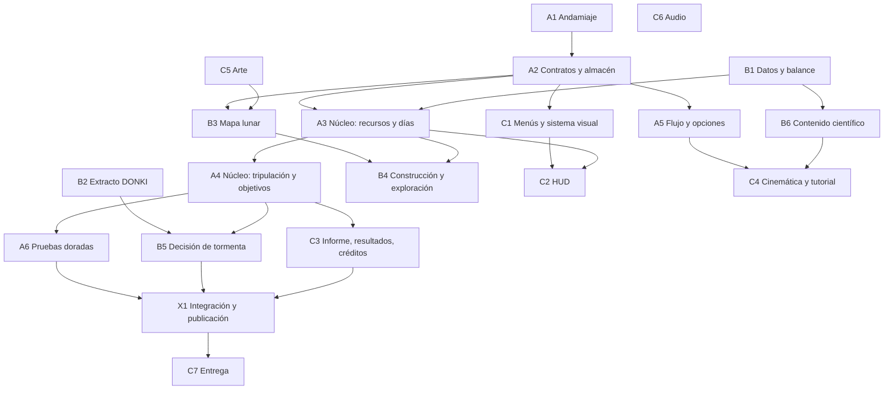

# Plan del equipo

Fuente canónica de **fechas, reparto y criterios de corte**. Horas en hora de Bolivia (UTC−4).

## 1. Fechas que mandan

| Cuándo | Qué | Fuente |
| --- | --- | --- |
| Sábado 14-nov, 09:00 | Empieza el trabajo y abre el formulario | Guía de entrega |
| Sábado 14-nov, 20:00 | Cierre de puertas de la sede | Agenda de la sede |
| **Domingo 15-nov, 09:30** | **Congelación interna de código** | Decisión del equipo |
| **Domingo 15-nov, 11:30** | **Pulsar Submit for Judging** | Decisión del equipo |
| Domingo 15-nov, 12:00 | Submit de proyectos en la sede | Agenda de la sede |
| Domingo 15-nov, 14:00 | Defensa de proyectos | Agenda de la sede |
| Domingo 15-nov, 23:59 | Cierre del formulario global | Guía de entrega |

Quedan unas 24 horas de reloj y cerca de 11 horas de trabajo efectivo por persona. **El compromiso es P0.**

## 2. Roles

A, B y C hasta que el equipo confirme nombres: `[POR COMPLETAR]`.

| Integrante | Desarrolla | Integra y verifica | Revisa a |
| --- | --- | --- | --- |
| **A · Simulación y arquitectura** | Configuración del proyecto, arranque del motor 2D, contratos, almacén de estado, turnos, recursos, tripulación, objetivos, flujo de escenas y pruebas de lógica | Contratos compartidos, cambios del núcleo, que `main` compile y pase pruebas | B |
| **B · Jugabilidad y ciencia** | Datos y balance, extracto DONKI, mapa, construcción, exploración, decisión de la tormenta, tarjetas científicas | Jugabilidad, recorridos por dificultad, que el dato NASA influya en una decisión | C |
| **C · Interfaz, arte y entrega** | Sistema visual, menús, HUD, informe y resultados, cinemática, tutorial, arte, audio, créditos, demo y formulario | Flujos en navegador, créditos, enlaces de entrega, coordinación con la sede | A |

Cada tarea tiene un responsable y un revisor. Paquetes de trabajo: [INTEGRANTE_A](../INTEGRANTE_A_SIMULACION.md), [INTEGRANTE_B](../INTEGRANTE_B_JUGABILIDAD_Y_CIENCIA.md), [INTEGRANTE_C](../INTEGRANTE_C_INTERFAZ_ARTE_Y_ENTREGA.md).

El reparto se adapta a las habilidades reales. Si alguien cambia de rol, se intercambian paquetes completos, no tareas sueltas, para no romper la propiedad de carpetas.

## 3. Cronograma

| Hito | Hora límite | Cierre comprobable |
| --- | --- | --- |
| **H0 · Arranque** | Sáb 12:45 | La documentación está en `main`. Los tres clonaron el repositorio y crearon su rama. |
| **H1 · Esqueleto** | Sáb 14:30 | `npm run dev`, `npm test` y `npm run build` funcionan en `main`. Existen `types.ts`, el almacén y los datos de prueba. Los JSON de balance cargan y se validan. El menú se ve con el sistema visual. |
| **H2 · Día reproducible** | Sáb 17:30 | La prueba del día 8 pasa. El mapa lunar se dibuja desde el estado y acepta construir. El HUD muestra el estado real y el botón Finalizar día avanza un día. |
| **H3 · Bucle completo** | Sáb 21:00 | Una partida en Media se juega del menú al resultado: construir, explorar, sombra, decisión de tormenta con tarjeta NASA, informe, victoria y derrota. **Primera publicación en la URL pública.** |
| Punto de control | Sáb 21:00 | Decisión de alcance con la tabla de la sección 6. |
| **H4 · P0 verificado** | Dom 09:00 | Los tres recorridos pasan como pruebas. Tutorial, tarjetas, inglés y español, audio, créditos y registro de IA. Probado en Chrome, Firefox y Edge sin errores de consola. |
| **Congelación** | Dom 09:30 | Solo se aceptan arreglos de fallos que impidan jugar. |
| **Entrega** | Dom 11:30 | Demo subida, formulario en inglés completo, enlaces probados en ventana privada, Submit for Judging pulsado. |
| Defensa | Dom 14:00 | Pitch ensayado dos veces. Partida de respaldo abierta en dos laptops. |

**Si el arranque se retrasa.** Estas horas suponen que el repositorio tiene la documentación y los tres han clonado a las 12:45 del sábado. Si eso ocurre más tarde, H1 y H2 se desplazan el mismo tiempo. **H3, la congelación y el envío no se mueven:** el retraso se absorbe recortando alcance con la tabla de la sección 6.

### Horas estimadas por integrante

| Tramo | Horas | A | B | C |
| --- | --- | --- | --- | --- |
| Sáb 12:45 – 14:30 (con almuerzo) | 1,0 | A1, A2 | B1, B2 | C1 |
| Sáb 14:30 – 17:30 | 3,0 | A2, A3 | B3 | C1, C2 |
| Sáb 17:30 – 21:00 | 3,5 | A4, A5 | B4, B5 | C2, C3 |
| Sáb 21:00 – 23:00 (si se puede) | 2,0 | A5, A6 | B5, B6 | C4, C5 |
| Dom 07:30 – 09:30 | 2,0 | A6, X1 | B6, pruebas de juego | C5, C6 |
| Dom 09:30 – 11:30 | 2,0 | X1: publicación y enlaces | Campo NASA Data, pruebas | C7: demo y formulario |
| **Total** | **13,5** | | | |

Estimación por tarea, en horas: A1 1,0 · A2 1,5 · A3 2,5 · A4 2,0 · A5 1,5 · A6 1,5 · X1 1,5 · B1 1,5 · B2 1,0 · B3 2,5 · B4 2,0 · B5 1,5 · B6 1,5 · C1 2,0 · C2 2,5 · C3 1,5 · C4 1,5 · C5 1,5 · C6 1,0 · C7 2,0.

Las charlas y la feria de la sede caen entre las 14:00 y las 17:00 del sábado. El equipo decide quién asiste; el plan supone que al menos dos siguen trabajando.

## 4. Tablero y dependencias

**Nadie espera parado.** B1, B2, C1, C5 y C6 no dependen del andamiaje: se empiezan en la rama propia desde el minuto uno. B3 y C2 trabajan contra `src/core/fixtures.ts` hasta que el núcleo real esté listo.

Tablero: una columna por estado (`propuesto`, `en desarrollo`, `integrado`, `verificado`) en GitHub Projects o en la tabla de [agentes/BACKLOG.md](agentes/BACKLOG.md). Cada integrante actualiza sus filas al cerrar una tarea.

## 5. Ruta P0, P1, P2

| Prioridad | Entrega | Condición de avance |
| --- | --- | --- |
| **P0** | Prototipo lunar completo, publicado y con demo | Recorrido desde el menú y compilación publicada |
| **P1** | Marte, bono único, guardado de campaña, opciones completas | Solo se empieza si H4 se cierra antes del domingo 09:00 y sobran horas, o después de la defensa |
| **P2** | Ruta secreta y misión terrestre | Solo después de P1 |

Backlog completo: [agentes/BACKLOG.md](agentes/BACKLOG.md).

## 6. Criterios para cortar alcance

En cada punto de control se mira esta tabla de arriba abajo. Lo primero que se corta es lo último de la lista.

**Nunca se corta:** la decisión de la tormenta con su tarjeta NASA, el informe con causa y efecto, una victoria y una derrota alcanzables, la versión en inglés, los créditos y el registro de IA.

| Si en... | ...falta esto | Se hace esto |
| --- | --- | --- |
| H2, sáb 17:30 | El mapa en Phaser no dibuja | B cambia a una cuadrícula de botones HTML. La interfaz `MapView` de `src/map/index.ts` no cambia. |
| H2 | El núcleo no pasa la prueba del día 8 | C y B siguen con datos de prueba. A no empieza A5 hasta arreglarlo. |
| H3, sáb 21:00 | No hay partida completa | Se cortan, en este orden: exploración con niebla (todo el mapa visible), tercer nivel de dificultad en pantalla (queda Media con las otras dos como datos), cinemática (una sola viñeta con texto), música (solo efectos). |
| H3 | No hay URL pública | A deja lo demás y publica. Es bloqueante. |
| H4, dom 09:00 | Falta español | Se entrega en inglés. El español queda oculto. |
| H4 | Falta arte | Se entregan formas de color con iconos y etiquetas. La mecánica manda sobre el pulido. |
| H4 | Fallan recorridos de Fácil o Imposible | Se entrega Media como dificultad probada y se rotulan las otras como "experimental". |
| Dom 09:30 | Cualquier cosa no terminada | Se oculta detrás de una bandera. No se entrega nada a medias. |

Si hay que reducir más: menos casillas, menos animaciones o menos variedad de edificios. **La relación entre ciencia y decisión de P0 se protege siempre.**

## 7. Definición de terminado

Una tarea está terminada cuando:

1. Cumple los criterios de aceptación de su ficha.
2. Sus pruebas pasan y `npm test` y `npm run build` siguen en verde en `main`.
3. El revisor la probó en el navegador o leyó el cambio.
4. No añade errores ni avisos a la consola.
5. Los textos visibles están en el catálogo, en inglés y español.
6. Los activos y usos de IA nuevos están en [IA-Y-CREDITOS.md](IA-Y-CREDITOS.md).
7. El estado de la tarea está actualizado en el backlog.

## 8. Lista de verificación de lanzamiento

Domingo, de 09:30 a 11:30. Cada línea tiene dueño.

- [ ] A · `main` compila y pasa todas las pruebas.
- [ ] A · La URL pública abre en ventana privada, en inglés, sin errores de consola.
- [ ] A · El repositorio es público y tiene `LICENSE`.
- [ ] B · Partida completa en Media con `?seed=demo` en la URL pública: victoria el día 9.
- [ ] B · La tarjeta de decisión muestra el identificador DONKI y el enlace abre.
- [ ] B · Campo "NASA Data" redactado.
- [ ] C · Demo: video de 30 s o menos con subtítulos en inglés, o PDF de 7 diapositivas o menos en inglés.
- [ ] C · Enlace de la demo abre en ventana privada y desde un teléfono.
- [ ] C · Formulario completo en inglés, copiado desde [ENTREGA.md](ENTREGA.md).
- [ ] C · Ningún material muestra a menores ni logotipos de NASA.
- [ ] C · [IA-Y-CREDITOS.md](IA-Y-CREDITOS.md) al día y reflejado en los campos de SI y de referencias.
- [ ] C · Los tres integrantes aparecen en la pestaña Members.
- [ ] Todos · Probado en Chrome, Firefox y Edge.
- [ ] C · **Submit for Judging** pulsado y aviso de confirmación capturado.
- [ ] Todos · Pitch ensayado dos veces con cronómetro.

## 9. Estado real

| Elemento | Estado |
| --- | --- |
| A y B · Arranque, núcleo, datos y mapa | Integrados en la raíz con las pruebas y la licencia MIT. La misión lunar usa registros DONKI incluidos. |
| C1 y C2 · Menús, opciones y HUD | Integrados con el flujo, el almacén y el tablero lunar. Continuar recupera la partida durante la sesión. |
| C3 · Informe, resultados y créditos | Integrados para P0. Se pueden leer informes y llegar a victoria y derrota. |
| C4 · Cinemáticas y aprendizaje | Apertura enlazada con el día 1. Las secuencias de P1/P2 se pueden abrir con los accesos de la vista de arte. |
| C5 · Arte | Atlas integrados en mapa y paleta. Luna y Marte tienen geometría y texturas propias. Marte permanece en la vista de arte. |
| C6 · Audio | Música y efectos de Web Audio instalados con el flujo y eventos del juego. |
| C7 · Entrega | Pendientes publicación, materiales de demo y comprobación de los requisitos del evento. |

[Comprobaciones del build y del navegador](DESPLIEGUE.md).
