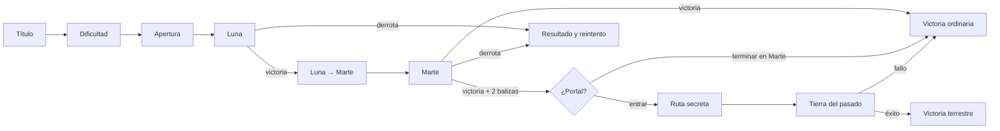

# Earth's Angel · documento de diseño

Fuente canónica de la **visión, la historia y el mundo**. Las reglas, los números y los contratos viven en sus fichas y aquí se enlazan.

## 1. Visión

**Earth's Angel** es un juego educativo 2D por turnos para navegador. El jugador dirige a la tripulación del Proyecto Last Hope, que debe levantar una base lunar autosuficiente antes de que se agote el plazo de la Tierra. Cada decisión cuesta algo: la electricidad que alimenta el invernadero no alimenta el generador de oxígeno, y los materiales del refugio no sirven para ampliar la base.

| | |
| --- | --- |
| Reto | *Build a Junior Astronaut Mission Trainer*, NASA Space Apps Challenge 2026 |
| Público | Niños de 7 a 12 años. Las dificultades altas dan juego a adolescentes y adultos. |
| Plataforma | Navegador de escritorio. Sin instalación, pago ni registro. |
| Idiomas | Inglés por defecto y español |
| Duración de una partida lunar | 10 a 20 minutos |
| Lo que el jugador se lleva | En el espacio nada es gratis, y los avisos de tormentas solares salen de datos reales |

**Título.** *Earth's Angel*, decidido por el equipo el 14-nov-2026. El nombre de trabajo anterior era *MoonBase Last Hope*. "Proyecto Last Hope" se conserva como nombre del programa dentro de la historia. Propuesta por confirmar: la nave se llama *Ángel* y la asistente de la base que guía el tutorial es ÁNGEL.

## 2. Historia y mundo

**Premisa (ficción).** En un futuro cercano, la crisis climática, la escasez de recursos y el deterioro de los ecosistemas ponen en riesgo a la civilización. El Proyecto Last Hope reúne a astronautas, científicos e ingenieros para desarrollar tecnologías de supervivencia, reciclaje y aprovechamiento de recursos. Su misión: construir una colonia lunar autosuficiente y después otra en Marte antes del punto crítico.

**Tono.** Esperanzador y concreto. La crisis se cuenta con ciudades apagadas, ríos bajos y cielos turbios. No hay imágenes gráficas ni víctimas en pantalla. Nadie muere en el juego: una tripulación que falla es evacuada.

**Personajes.** Cuatro tripulantes en la Luna, seis en Marte, identificados por rol y no por nombre real: comandante, ingeniera, botánico, médica; en Marte se suman un geólogo y una especialista en comunicaciones. ÁNGEL es la voz de la base.

**Mensaje final.** "El futuro comienza aprendiendo a cuidar nuestro hogar. Todavía estamos a tiempo de proteger la Tierra."

Guion completo: [GUION-CINEMATICAS.md](GUION-CINEMATICAS.md).

## 3. Recorrido del juego

| Fase | Contenido | Prioridad |
| --- | --- | --- |
| Luna, el primer refugio | Mapa de 12 × 12, siete edificios, sombra y tormenta solar con dato NASA | **P0** |
| Marte, la nueva frontera | Mapa de 20 × 20, tormentas de polvo, mantenimiento, logística y comunicaciones | P1 |
| Tierra, Proyecto Segunda Oportunidad | Epílogo jugable con presupuesto y metas ambientales | P2 |

Diseño de cada nivel: [niveles/luna.md](niveles/luna.md), [niveles/marte.md](niveles/marte.md), [niveles/tierra-alternativa.md](niveles/tierra-alternativa.md).

## 4. Bucle jugable

Cada día el jugador hace cuatro cosas:

1. **Mira** el estado de la colonia y el pronóstico.
2. **Decide**, si hay alerta de radiación, entre refugiar a la tripulación o seguir trabajando.
3. **Actúa** con sus puntos de acción: construir, explorar o recolectar. También enciende, apaga y prioriza módulos.
4. **Finaliza el día.** La simulación calcula energía, módulos, consumo y exposición, y muestra un informe con causa y efecto.

Orden exacto de un día y ejemplo con cifras: [componentes/ciclo-de-dias.md](componentes/ciclo-de-dias.md).

### Compromisos visibles

| Decisión | Lo que ganas | Lo que pagas |
| --- | --- | --- |
| Refugiar a la tripulación en la tormenta | Exposición mínima | Energía y el día de trabajo |
| Dar electricidad al invernadero con poca luz | La cosecha llega a tiempo | Batería, y quizá el generador se apaga |
| Gastar materiales en el refugio | Protección | Menos paneles o un segundo invernadero |
| Construir una batería | Aguantas la sombra | Un panel menos |
| Explorar | Hielo y minerales | Puntos de acción que no construyen |

No hay opción segura sin costo. Es la petición central del reto.

### Variables

| Variable | Ficha |
| --- | --- |
| Electricidad | [energia](componentes/energia.md) |
| Oxígeno | [soporte-vital](componentes/soporte-vital.md) |
| Agua y alimentos | [agua-y-alimentos](componentes/agua-y-alimentos.md) |
| Radiación | [radiacion-y-refugio](componentes/radiacion-y-refugio.md) |
| Materiales | [motor-recursos](componentes/motor-recursos.md), [construccion](componentes/construccion.md) |
| Tripulación | [tripulacion](componentes/tripulacion.md) |
| Autonomía y victoria | [objetivos](componentes/objetivos.md) |

## 5. Victoria, derrota y resultado

- **Victoria lunar:** seis objetivos cumplidos al cerrar un día: soporte vital, energía, alimentos, reservas, protección demostrada y racha de estabilidad. Definición en [objetivos](componentes/objetivos.md).
- **Derrota:** plazo agotado, colapso del soporte vital, exposición extrema, escasez irrecuperable o un objetivo obligatorio incumplido.
- **Resultado:** causa, decisiones y recursos implicados, un principio científico y una sugerencia concreta para el siguiente intento. Diseño en [resultados-y-finales](componentes/resultados-y-finales.md).
- **Reintento:** "Reintentar misión" reinicia el nivel con la misma dificultad y semilla.

## 6. Dificultades

| | Fácil | Media | Imposible |
| --- | --- | --- | --- |
| Para quién | Primera partida, 7 a 9 años | Quien ya entendió el bucle | Adolescentes y adultos |
| Reservas iniciales | Amplias | Justas | Mínimas |
| Ventana lunar | 24 días | 20 días | 16 días |
| Tormenta solar | Moderada, 1 día | Severa, 1 día | Severa, 2 días |
| Racha exigida | 2 días | 3 días | 4 días |
| Recorrido de referencia | Victoria el día 9 | Victoria el día 9 | Victoria el día 13 |

Las reglas son las mismas en las tres. Cambian reservas, plazos y eventos. Tablas completas: [dificultad-y-balance](componentes/dificultad-y-balance.md).

## 7. Menú, opciones e interfaz

### Pantalla de inicio

Título, logotipo propio y fondo espacial con animación ligera. Botones: **Nueva partida**, **Opciones**, **Salir**. Con partida guardada aparece **Continuar** (P1). Selector de idioma visible. Ficha: [menu-principal](componentes/menu-principal.md).

- **Nueva partida** abre Fácil, Media, Imposible. Al elegir, empieza la historia. Ficha: [selector-dificultad](componentes/selector-dificultad.md).
- **Salir** pide confirmación si hay partida activa y abre una despedida con el audio detenido, un botón para volver al título y la indicación de que la pestaña se puede cerrar.

### Opciones

Volumen general, música y efectos; silencio; controles; subtítulos activados por defecto; movimiento reducido; idioma; pantalla completa donde el navegador lo permita; volver. Cambiar una opción nunca toca la partida. Ficha: [menu-opciones](componentes/menu-opciones.md).

### HUD

El reto advierte de no abrumar con demasiados sistemas y sugiere dos o tres recursos principales. Por eso el HUD muestra **tres medidores** y deja el detalle a un toque:

| Medidor | Resume | Detalle al abrir |
| --- | --- | --- |
| ⚡ Energía | Batería y balance del día | Generación, consumo, módulos sin electricidad |
| 🫧 Soporte vital | El peor de oxígeno, agua y alimentos, en días de margen | Reservas y flujo de cada uno |
| 🛡 Protección | Exposición máxima y estado del refugio | Exposición por tripulante |

Además: día de misión y plazo terrestre, materiales, puntos de acción, objetivos, pronóstico, estado de la tripulación, y los botones Construir, Finalizar día, Pausa y Opciones. Tutorial y tarjetas científicas se consultan con el botón "?". Cada estado se muestra con **texto, icono y color**: seguro ✔, preventivo ▲, crítico ✖. Referencia 16:9 de escritorio. Ficha: [hud-y-accesibilidad](componentes/hud-y-accesibilidad.md).

## 8. Cinemáticas

Cuatro secuencias 2D por viñetas, todas con **«Saltar (Intro)»** abajo a la derecha: apertura, Luna → Marte, victoria ordinaria, y ruta secreta con victoria terrestre. Guion: [GUION-CINEMATICAS.md](GUION-CINEMATICAS.md). Motor: [motor-cinematicas](componentes/motor-cinematicas.md). Ver o saltar una escena produce el mismo estado.

## 9. Ciencia y datos

La tormenta solar de la misión es un registro real de NASA DONKI. La tarjeta de decisión muestra identificador, fecha, instrumento y enlace, y dice que es un dato archivado. Dosis y umbrales son unidades de juego. Todo en [CIENCIA-Y-DATOS.md](CIENCIA-Y-DATOS.md).

## 10. Metas por fase

| Fase | Entrega jugable | Condición de avance | Estado |
| --- | --- | --- | --- |
| **P0 · Prototipo lunar** | Web, menú, tres dificultades, apertura saltable, mapa, construcción, ciclo de días, soporte vital, energía, alimentos, protección radiativa, sombra y tormenta solar, decisión con dato NASA, victoria y derrota, informe, música lunar, efectos básicos, créditos | Recorrido completo desde el menú y compilación publicada | Propuesto |
| **P1 · Campaña principal** | Transición Luna → Marte con bono único, mapa marciano, polvo y logística, objetivos marcianos, música propia, victoria normal, guardado de campaña, opciones completas | P0 verificado | Propuesto |
| **P2 · Segunda Oportunidad** | Búsqueda y pistas, portal, misión terrestre, cinemáticas y final alternativo | P1 verificado | Propuesto |

**Compromiso para el envío del domingo 15-nov a las 12:00: P0.** P1 y P2 están diseñados y documentados. Plan y criterios de corte: [PLAN-EQUIPO.md](PLAN-EQUIPO.md).

## 11. Qué queda fuera

- Multijugador, cuentas, tablas de puntuación en línea.
- API en vivo. Queda como ampliación.
- Móvil y pantallas táctiles como plataforma principal.
- Mover o demoler edificios.
- Tripulantes con nombre, historia personal o muerte.

## 12. Decisiones pendientes del equipo

1. Confirmar o cambiar los nombres *Ángel* y ÁNGEL.
2. Confirmar nombres reales de A, B y C y el nombre del equipo.
3. Revisar la tabla de propuestas de la IA en [NASA-SPACE-APPS-2026.md](NASA-SPACE-APPS-2026.md#4-decisiones-creativas).
4. Elegir licencia.
5. Decidir si la demo es video de 30 segundos o 7 diapositivas. Recomendación: video, con las diapositivas como apoyo para la defensa presencial.
