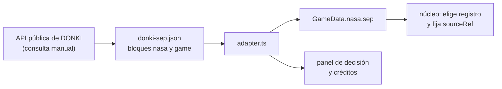

# Adaptador de datos NASA

## 1. Identificación y límites

| Campo | Valor |
| --- | --- |
| ID | C-28 |
| Prioridad · fase | P0 · H1 |
| Objetivo | Empaquetar un extracto trazable de registros DONKI y ofrecerlo al juego separando lo que es de la fuente de lo que es del juego. |
| Responsabilidad | `src/data/nasa/donki-sep.json`, `src/data/nasa/adapter.ts` |
| Depende de | [CIENCIA-Y-DATOS.md](../CIENCIA-Y-DATOS.md) |
| No incluye | Llamadas a la API en ejecución. La decisión de refugio. |
| Responsable · revisor | B · A |
| Estado | Propuesto. Registro principal leído de la fuente el 14-nov-2026. |

## 2. Arquitectura y funcionamiento

El juego **no llama a ninguna API**. El extracto se prepara a mano una vez, se revisa y se empaqueta. Así la demo funciona sin red ni claves, y nadie puede confundir un dato archivado con uno en vivo.



### Contrato

```ts
export interface NasaSepRecord {
  nasa: {                         // copiado tal cual de la fuente
    sepID: string;
    eventTime: string;            // UTC, formato de la fuente
    instrument: string;
    link: string;
    flare: {
      flrID: string; classType: string;
      beginTime: string; peakTime: string;
      sourceLocation: string; activeRegionNum: number | null;
      link: string;
    } | null;
  };
  game: {                         // transformación didáctica
    radiationLevel: 1 | 2;
    rule: string;                 // regla aplicada, legible
    leadMinutes: number | null;   // eventTime − flare.beginTime
  };
}

export function loadSepRecords(): NasaSepRecord[];
export function findSepRecord(sepID: string): NasaSepRecord | null;
export function recordsByLevel(level: 1 | 2): NasaSepRecord[];
export function describeSepRecord(r: NasaSepRecord): {
  id: string; dateISO: string; link: string; instrument: string;
  flareClass: string | null; activeRegion: number | null; leadMinutes: number | null;
};
```

### Flujo

1. `loadGameData` llama a `loadSepRecords` y valida cada registro.
2. El núcleo, al crear la misión, elige un registro del nivel que pide la dificultad y pone su `sepID` en `sourceRef` del evento.
3. El panel de decisión llama a `findSepRecord(event.sourceRef)` y a `describeSepRecord`.
4. Los créditos listan los registros usados con su enlace.

## 3. Datos y uso

Formato del archivo, registro principal y candidatos: [CIENCIA-Y-DATOS.md](../CIENCIA-Y-DATOS.md#2-fuente-integrada-donki).

### Reglas de transformación

| Campo del juego | Regla |
| --- | --- |
| `radiationLevel` | El instrumento menciona "100 MeV" → 2. Menciona "10 MeV" y el evento no tiene registro de 100 MeV → 1. |
| `leadMinutes` | Minutos entre `flare.beginTime` y `eventTime`. Sin fulguración enlazada → `null` y el panel omite la frase. |
| `rule` | Texto de la regla aplicada, para que se pueda auditar. |

### Validación al cargar

- `sepID`, `eventTime`, `instrument` y `link` no vacíos. `link` empieza por `https://ccmc.gsfc.nasa.gov/`.
- `radiationLevel` coherente con `instrument` según la regla.
- Ningún `sepID` repetido.
- Hay al menos un registro de cada nivel que use alguna dificultad.
- Ningún registro contiene la palabra `SYNTHETIC`.

### Recuperación de errores

- `findSepRecord` de un id que no existe devuelve `null`. El panel muestra entonces "Datos de prueba" y no enseña enlace.
- Si el extracto no supera la validación, el juego no arranca y dice qué registro falla. Es preferible a mostrar un dato falso.

### Crédito visible

En el panel y en los créditos: "Space weather event records: NASA CCMC DONKI. Archived data, not a live feed." Texto de reconocimiento de CCMC: por verificar.

### Ampliación futura

Consulta en vivo con clave de NASA Open APIs, con el extracto como respaldo. Fuera del prototipo.

## 4. Implementación delegable

**Tarea:** [T-P0-B2](../agentes/tareas/T-P0-B2-extracto-donki.md).

**Prompt breve:**

```text
Crea src/data/nasa/donki-sep.json con el formato y el registro principal de
docs/CIENCIA-Y-DATOS.md y src/data/nasa/adapter.ts con el contrato de
docs/componentes/adaptador-datos-nasa.md. Vuelve a leer cada registro en la API antes de
copiarlo. No inventes ni completes campos: lo que no esté en la fuente va como null.
```

**Pruebas:** D-NASA-01 a D-NASA-03 en [PRUEBAS.md](../PRUEBAS.md).

**Criterios de aceptación:** el registro principal tiene `leadMinutes` 50 y nivel 2; cada campo de `nasa` se comprueba abriendo su enlace; quitar el extracto impide arrancar.

**Evidencia:** pruebas en verde y enlaces abiertos.

**Terminado cuando:** el panel de decisión muestra el registro en la URL pública.

**Riesgos:** copiar mal un campo. Mitigación: copiar y pegar desde la respuesta de la API, nunca teclear.
