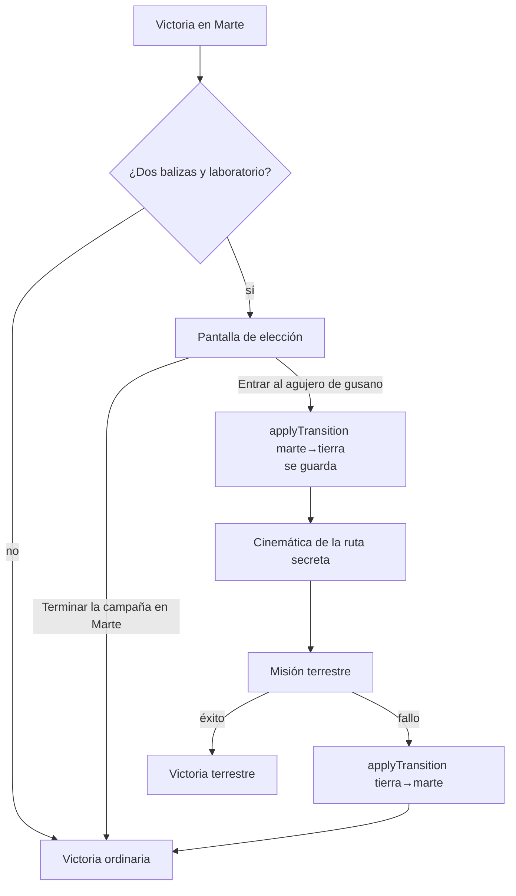

# Agujero de gusano

Verificado en la campaña local. El recorrido y sus resultados están en [PRUEBAS.md](../PRUEBAS.md#verificación-de-campaña).

## 1. Identificación y límites

| Campo | Valor |
| --- | --- |
| ID | C-24 |
| Prioridad · fase | P2 |
| Objetivo | Abrir el desenlace alternativo solo cuando se cumplen sus condiciones y dar al jugador una elección clara. |
| Responsabilidad | Acción `ACTIVATE_BEACONS` y transición `marte->tierra` (A), pantalla de elección y cinemática (C) |
| Depende de | [objetos-secretos](objetos-secretos.md), [progresion](progresion.md), [objetivos](objetivos.md), [motor-cinematicas](motor-cinematicas.md) |
| No incluye | La misión terrestre ([mision-terrestre](mision-terrestre.md)). |
| Responsable · revisor | C (pantalla) y A (núcleo) · A |
| Estado | Implementado y probado. Todo es `ficción`. |

## 2. Arquitectura y funcionamiento

### Condiciones del portal

El portal sigue cerrado hasta que se cumplen **las tres**:

1. Banderas `beaconMoon` y `beaconMars`.
2. Laboratorio operativo en Marte.
3. Objetivos de Marte cumplidos: la misión está ganada.

`ACTIVATE_BEACONS` sin alguna de ellas se rechaza y el mensaje dice cuál falta. No hay forma de entrar al portal por otra vía.

### Flujo



### Pantalla de elección

Escena `eleccion`. Dos botones del mismo tamaño, sin opción destacada:

| Opción | Texto | Consecuencia |
| --- | --- | --- |
| Terminar en Marte | "La colonia está a salvo. Empieza una nueva etapa." | Victoria ordinaria |
| Entrar al portal | "Las balizas abren un paso al pasado de la Tierra. Hay una última misión." | Misión terrestre |

Antes de confirmar el portal, un aviso: "Si la misión en la Tierra falla, volverás al final de Marte. No pierdes tu victoria."

### Una sola vez

`marte->tierra` es una transición idempotente ([progresion](progresion.md)). Se aplica y se guarda antes de la cinemática. Saltar la escena, verla o recargar dan el mismo estado.

## 3. Datos y uso

- **Ficción declarada.** La pantalla de elección lleva una nota: "El viaje en el tiempo es parte de la historia, no ciencia real."
- **Sin presión de tiempo.** La elección no caduca.
- **Efectos:** el portal se dibuja como un anillo de luz sobre el laboratorio. Con movimiento reducido, anillo fijo.
- **Audio:** `sfx-portal` al confirmar.
- **Claves de texto:** `ui.choice.*`.

### Casos límite

- Balizas halladas pero Marte perdido: no hay elección; resultado de derrota normal.
- Recarga en la pantalla de elección: se vuelve a mostrar; nada se ha aplicado todavía.
- Fallo en la Tierra y nuevo intento: la partida ofrece reintentar la misión terrestre antes de aceptar el final de Marte.

## 4. Implementación delegable

**Tareas:** T-P2-A1 y T-P2-C1 en [P2-segunda-oportunidad.md](../agentes/tareas/P2-segunda-oportunidad.md).

**Prompt breve:**

```text
Implementa el portal según docs/componentes/agujero-de-gusano.md: ACTIVATE_BEACONS con sus tres
condiciones, escena eleccion con dos opciones equivalentes y transición marte->tierra aplicada
y guardada antes de la cinemática.
```

**Pruebas:** U-SEC-06 a U-SEC-09 e I-CAM-03 en [PRUEBAS.md](../PRUEBAS.md).

**Criterios de aceptación:** sin las dos balizas no aparece la elección; con ellas aparecen las dos opciones; elegir el portal crea la misión terrestre una sola vez; un fallo terrestre devuelve la victoria de Marte.

**Evidencia:** pruebas en verde y captura de la elección.

**Terminado cuando:** las dos ramas llegan a su final desde la misma partida guardada.

**Riesgos:** que el final secreto parezca el "verdadero" y reste valor al ordinario. Mitigación: dos botones iguales y dos finales completos.
