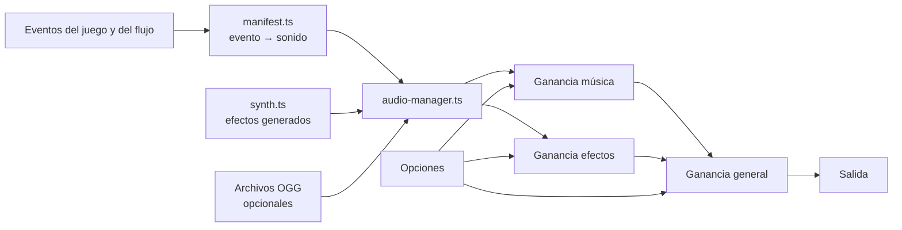

# Audio

## 1. Identificación y límites

| Campo | Valor |
| --- | --- |
| ID | C-26 |
| Prioridad · fase | P0 · H4 |
| Objetivo | Dar música y efectos con volúmenes independientes, sin que el juego dependa de ningún archivo de sonido. |
| Responsabilidad | `src/audio/audio-manager.ts`, `synth.ts`, `manifest.ts`, `index.ts` |
| Depende de | [arranque-y-escenas](arranque-y-escenas.md) (`AudioApi`, `Options`), [ARTE-Y-ACTIVOS.md](../ARTE-Y-ACTIVOS.md) |
| No incluye | Voces ni narración hablada. |
| Responsable · revisor | C · A |
| Estado | Música y efectos integrados con el flujo real de P0. Los temas de Marte y Tierra están disponibles en la vista de arte. |

## 2. Arquitectura y funcionamiento



- **Web Audio API** del navegador. Sin bibliotecas.
- **Tres ganancias:** general, música y efectos. `volumen efectivo = general × canal`. Silencio pone la general en 0.
- **Inicio tras una interacción.** El contexto se crea o se reanuda en el primer clic o tecla (`audio.unlock()`). Una solicitud de música previa a la interacción queda en espera.
- **Transiciones:** al cambiar de pista, fundido cruzado de 800 ms.
- **Suscripción.** El arranque y la vista de arte conectan los eventos y el flujo con `attachAudio(audio, store, flow)`. Las pantallas solicitan su pista y los guiones pueden disparar efectos como despegue o portal.

### Plan sin archivos

`synth.ts` genera todos los efectos con osciladores y envolventes, y temas estéreo con motivos, acordes y pulsos por escena. Cada pista se genera una vez por contexto de audio. Si un OGG del manifiesto existe, se usa; si no, suena el sintetizado. **El juego nunca falla ni se queda mudo por un archivo ausente.**

Ventajas para el hackathon: sin licencias que revisar, sin peso, sin descargas.

## 3. Datos y uso

### Música

El tema del nivel sigue sonando durante la pausa y las opciones abiertas desde la misión. Los guiones seleccionan su propio tema y disparan los efectos sincronizados. Los resultados suenan una vez. [Pistas y duraciones](../ARTE-Y-ACTIVOS.md#6-manifiesto-sonoro).

### Efectos

| ID | Evento | Carácter |
| --- | --- | --- |
| `sfx-click` | Botón | Clic corto |
| `sfx-confirm` | Confirmar un diálogo | Dos notas ascendentes |
| `sfx-build` | `building/placed` | Golpe y zumbido |
| `sfx-online` | `building/operational` | Confirmación de módulo activo |
| `sfx-error` | `action/rejected` | Nota grave breve |
| `sfx-explore` | `tile/explored` | Barrido suave |
| `sfx-collect` | `resource/collected` | Tintineo |
| `sfx-produce` | `harvest/done` | Acorde corto |
| `sfx-day-end` | `day/ended` | Campanada suave |
| `sfx-alert-radiation` | `decision/required` | Tres pulsos |
| `sfx-alert-shortage` | `alert/shortage` | Dos pulsos graves |
| `sfx-breakdown` | Avería (P1) | Chispa |
| `sfx-objective` | `objective/met` | Arpegio ascendente |
| `sfx-discovery` | `discovery/found` | Nota larga con eco |
| `sfx-launch` | Despegue en cinemática | Rumor creciente |
| `sfx-portal` | Portal (P2) | Barrido descendente |
| `sfx-radio` / `sfx-landing` | Viñetas de planificación y llegada | Pulsos de radio y descenso |
| `sfx-dust` | Polvo marciano | Ráfaga breve en la vista de arte y ante un evento marciano compatible |
| `sfx-victory`, `sfx-defeat` | Fin de misión | Fanfarria corta · caída suave |

Esta versión sintetiza los sonidos en el navegador. El manifiesto conserva rutas opcionales para OGG. Detalle de licencias en el manifiesto de [ARTE-Y-ACTIVOS.md](../ARTE-Y-ACTIVOS.md).

### Reglas

- Volumen parejo entre pistas. Nada estridente: el público son niños.
- **Todo aviso sonoro importante tiene su equivalente en pantalla.** El audio nunca es la única señal.
- Una alerta no se repite en bucle: suena una vez.
- Con la pestaña oculta, el contexto se suspende.
- Audio generado con IA: se reconoce en créditos y en el campo de comentario del archivo.

### Casos límite

- Navegador que bloquea el audio: el juego funciona en silencio.
- Muchos efectos a la vez: máximo ocho voces; las más antiguas se cortan.
- Cambio de escena a mitad de un fundido: el fundido nuevo parte del volumen actual.
- Bucle con clic en la unión: usar el colchón sintetizado.

## 4. Implementación delegable

**Tarea:** [T-P0-C6](../agentes/tareas/T-P0-C6-audio.md).

**Prompt breve:**

```text
Implementa src/audio según docs/componentes/audio.md: createAudio(options) devuelve un AudioApi
con tres ganancias, desbloqueo en la primera interacción, fundido de 800 ms entre pistas y
efectos sintetizados para toda la tabla P0. Si existe el OGG del manifiesto se usa; si no, el
sintetizado. Sin dependencias.
```

**Pruebas:** M-AUD-01 a M-AUD-05 en [PRUEBAS.md](../PRUEBAS.md).

**Criterios de aceptación:** sin interacción no hay sonido ni errores; los tres volúmenes actúan por separado y al instante; sin archivos el juego suena; cada alerta sonora tiene su aviso visual.

**Evidencia:** lista de sonidos implementados y consola limpia.

**Terminado cuando:** A cablea `createAudio` y el recorrido de Media suena de principio a fin.

**Riesgos:** políticas de reproducción automática. Mitigación: desbloqueo explícito en el primer gesto.
