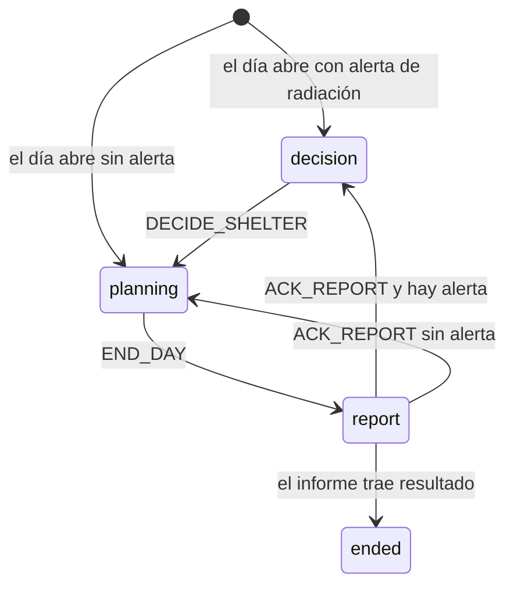

# Ciclo de días

Fuente canónica del **orden de operaciones de un turno**. Las fórmulas de cada sistema están en su ficha y se enlazan desde aquí.

## 1. Identificación y límites

| Campo | Valor |
| --- | --- |
| ID | C-16 |
| Prioridad · fase | P0 · Hito 2 |
| Objetivo | Convertir las decisiones del día en un estado nuevo, un informe y un resultado, siempre en el mismo orden. |
| Responsabilidad | `advanceDay`, apertura del día, cálculo de puntos de acción, fases de la misión. |
| Depende de | [motor-recursos](motor-recursos.md), [energia](energia.md), [soporte-vital](soporte-vital.md), [agua-y-alimentos](agua-y-alimentos.md), [radiacion-y-refugio](radiacion-y-refugio.md), [tripulacion](tripulacion.md), [objetivos](objetivos.md), [eventos-ambientales](eventos-ambientales.md) |
| No incluye | Validación de construir y explorar ([construccion](construccion.md), [mapa](mapa.md)). Transiciones entre niveles ([progresion](progresion.md)). |
| Responsable · revisor | A · B |
| Estado | Propuesto. Reglas validadas con un modelo de referencia el 14-nov-2026 (ver [PRUEBAS.md](../PRUEBAS.md)). |

## 2. Arquitectura y funcionamiento

**Módulo:** `src/core/day-cycle.ts`. **Funciones:** `startDay(state, data)`, `advanceDay(state, data)`. Tipos en [ARQUITECTURA.md](../ARQUITECTURA.md#5-contratos-typescript).

### Qué consume un turno

Solo **Finalizar día** (`END_DAY`) hace avanzar el tiempo. Construir, explorar y recolectar gastan **puntos de acción (PA)** del día y se confirman al instante: el costo se descuenta en el momento y no se puede deshacer. Encender, apagar y reordenar prioridades es gratis.

### Fases de la misión



| Fase | Acciones aceptadas |
| --- | --- |
| `decision` | `DECIDE_SHELTER` |
| `planning` | `BUILD`, `EXPLORE`, `COLLECT`, `TOGGLE_BUILDING`, `SET_ENERGY_PRIORITY`, `END_DAY` |
| `report` | `ACK_REPORT` |
| `ended` | `RESTART_MISSION` |

Cualquier otra combinación se rechaza con `WRONG_PHASE`.

### Apertura del día: `startDay`

1. `ap = sanos + floor(enObservacion / 2)`. Sano: salud > 0 y exposición < 50. En observación: exposición de 50 a 99. Ver [tripulacion](tripulacion.md).
2. `apSpentToday = 0`, `shelterToday = false`.
3. Si hoy hay un evento con `radiationLevel > 0`: `phase = 'decision'`, `decisionPending = evento.id` y se emite `decision/required`. Si no, `phase = 'planning'`.
4. Se emite `day/started` y un `event/forecast` por cada evento dentro del horizonte de pronóstico.

### Decisión de refugio: `DECIDE_SHELTER`

- `shelter: true` exige un refugio operativo (`NO_SHELTER`) y que `energia + generación de hoy >= shelterEnergy` (`NO_ENERGY_FOR_SHELTER`). Efecto: `shelterToday = true` y `ap = 0`.
- `shelter: false` no exige nada. Los PA quedan intactos.
- En ambos casos `phase = 'planning'` y `decisionPending = null`.
- En un evento de varios días la decisión se toma **cada día**.

### Cierre del día: `advanceDay`

Diez pasos. El orden es parte del contrato.

| Paso | Qué ocurre | Ficha |
| --- | --- | --- |
| 1. Validar | `phase === 'planning'` y `action.day === mission.day`. Si no, rechazo. | — |
| 2. Eventos | `solar` = factor del evento de hoy o 100. `rad` = nivel de radiación de hoy o 0. | [eventos-ambientales](eventos-ambientales.md) |
| 3. Generar | `capE = cap base + 20 × baterías operativas`. `gen = floor(paneles operativos × 8 × solar / 100)`. `disponible = energia + gen`. | [energia](energia.md) |
| 4. Asignar electricidad | Si `shelterToday`, el refugio va primero con `shelterEnergy`. Después, cada edificio operativo y encendido en el orden de `energyPriority`. Si `disponible >= consumo`, se enciende y se descuenta. Si no, queda sin electricidad. | [energia](energia.md) |
| 5. Operar módulos | Orden fijo: extractor → reciclador → generador → invernadero. Los módulos solo usan agua por encima de la que la tripulación necesita hoy. | [agua-y-alimentos](agua-y-alimentos.md), [soporte-vital](soporte-vital.md) |
| 6. Consumo de la tripulación | Oxígeno, agua y alimentos, en ese orden. Una unidad por tripulante. Las faltas bajan la salud. | [soporte-vital](soporte-vital.md), [tripulacion](tripulacion.md) |
| 7. Exposición | +1 de fondo a todos. Con radiación: valor con refugio o sin refugio. | [radiacion-y-refugio](radiacion-y-refugio.md) |
| 8. Reservas | `energia = disponible`. Cada recurso se recorta a su capacidad y el exceso se anota como desperdicio. | [motor-recursos](motor-recursos.md) |
| 9. Evaluar | Estabilidad del día, racha, objetivos y resultado. | [objetivos](objetivos.md) |
| 10. Reloj e informe | `day += 1`, `earthDaysRemaining -= 1`, `phase = 'report'` o `'ended'`. Se construye el `DayReport`. | — |

**Cuándo se aplica cada efecto.** Lo producido hoy está disponible para el consumo de hoy, porque los módulos operan antes de que la tripulación consuma. Un edificio colocado hoy empieza a funcionar el día `operationalFromDay`. El agua reciclada hoy sale del agua que la tripulación bebió ayer.

### Precedencia del resultado (paso 9)

1. Algún tripulante con salud 0 → derrota `soporte-vital`.
2. Algún tripulante con exposición ≥ 100 → derrota `exposicion`.
3. Todos los objetivos cumplidos → **victoria**, también si hoy era el último día.
4. `day >= dayLimit` o el plazo terrestre llega a 0 → derrota `plazo`.

El fallo crítico gana al éxito. El éxito gana al plazo.

### Eventos emitidos

`day/started`, `decision/required`, `decision/made`, `building/operational`, `building/unpowered`, `harvest/done`, `alert/radiation`, `alert/shortage`, `objective/met`, `streak/changed`, `day/ended`, `mission/victory`, `mission/defeat`.

## 3. Datos y uso

Parámetros en [dificultad-y-balance.md](dificultad-y-balance.md). Edificios en [construccion.md](construccion.md).

### Ejemplo numérico de un día completo

Luna, dificultad Media, programa canónico, **día 8**, siguiendo el recorrido de [niveles/luna.md](../niveles/luna.md). Todos los números son **valores de balance** en unidades de juego.

Estado al abrir el día: energía 24 de 40 · oxígeno 20 · agua 25 · alimentos 28 · materiales 14 · exposición 7 · salud 100 · racha 1. Operativos: 3 paneles, 1 batería, extractor, reciclador, generador, invernadero y refugio.

| Paso | Cálculo | Resultado |
| --- | --- | --- |
| Evento | Tormenta solar severa (nivel 2). Sol al 100 %. | Fase `decision` |
| Decisión | El jugador elige **Refugiar**. 24 + 24 ≥ 6, se acepta. | PA = 0 |
| Generar | 3 × 8 × 100 / 100 = 24. Disponible = 24 + 24. | 48 |
| Asignar | Refugio 6 → generador 4 → reciclador 3 → extractor 3 → invernadero 4. | Usado 20, quedan 28 |
| Extractor | +6 de agua. | Agua 31 |
| Reciclador | floor(4 × 75 / 100) = 3. | Agua 34 |
| Generador | 34 − 4 de la tripulación = 30 ≥ 2. Gasta 2 de agua, da 6 de oxígeno. | Agua 32 · oxígeno 26 |
| Invernadero | 32 − 4 = 28 ≥ 2. Gasta 2 de agua. Cultivo 1 de 4. | Agua 30 |
| Tripulación | 4 de oxígeno, 4 de agua, 4 de alimentos. Sin faltas. | Oxígeno 22 · agua 26 · alimentos 24 |
| Exposición | 7 + 1 de fondo + 5 con refugio. | 13 |
| Reservas | Energía 28 de 40. Nada se desperdicia. | — |
| Evaluar | Día estable. Racha 2 de 3. Objetivos: todos menos `racha`. | Sigue la misión |
| Reloj | Día 9. Plazo terrestre de 47 a 46. | — |

### Dos decisiones ante el mismo evento

Mismo estado inicial, mismo día 8. La única diferencia es la respuesta a la tormenta.

| | Refugiar | Seguir trabajando |
| --- | --- | --- |
| PA del día 8 | 0 | 4 (segundo invernadero y dos exploraciones) |
| Energía al cerrar el día 8 | 28 | 34 |
| Exposición al cerrar el día 8 | 13 | 58, en observación |
| Racha al cerrar el día 8 | 2 | 0 |
| PA por día desde el día 9 | 4 | 2 |
| Día de la victoria | **9** | **11** |
| Exposición final | 14 | 61 |
| Plazo terrestre restante | 45 | 43 |

Qué cambió: refugiarse cuesta 6 de energía y un día de trabajo. No refugiarse ahorra eso, pero la tripulación queda en observación médica, rinde la mitad y la racha vuelve a empezar. En Imposible la tormenta dura dos días y trabajar los dos termina la misión por exposición el día 9.

### Casos límite

- `END_DAY` con `day` distinto del actual → `STALE_DAY`, sin cambios. Cubre la doble pulsación.
- `END_DAY` durante `decision` → `DECISION_PENDING`.
- Tripulante con salud 0 no consume ni aporta PA. En P0 eso ya es derrota, así que no ocurre en una misión viva.
- Día 1: `wastewater` vale 0, el reciclador no devuelve nada.
- Victoria y plazo el mismo día: gana la victoria.
- Fallo de soporte vital y objetivos cumplidos el mismo día: gana la derrota.

## 4. Implementación delegable

**Tarea:** [T-P0-A3](../agentes/tareas/T-P0-A3-nucleo-recursos-y-dias.md) y [T-P0-A4](../agentes/tareas/T-P0-A4-nucleo-tripulacion-y-objetivos.md).

**Prompt breve:**

```text
Implementa src/core/day-cycle.ts siguiendo docs/componentes/ciclo-de-dias.md al pie de la letra:
startDay y advanceDay con los diez pasos en ese orden, solo enteros, sin mutar la entrada.
Usa los tipos de src/core/types.ts sin cambiarlos. Escribe en tests/core/day-cycle.test.ts
el ejemplo numérico del día 8 y la tabla de dos decisiones como pruebas exactas.
```

**Pruebas:** unitarias U-DIA-01 a U-DIA-08 y de integración I-REC-MEDIA en [PRUEBAS.md](../PRUEBAS.md).

**Criterios de aceptación:**

- La prueba del día 8 reproduce cada fila de la tabla.
- Las dos ramas de la decisión terminan en los días 9 y 11 con las exposiciones 14 y 61.
- Dos `END_DAY` seguidos con el mismo `day` avanzan un solo día.
- `advanceDay` no cambia el objeto de estado que recibe.

**Evidencia:** salida de `npm test` con las pruebas de este archivo en verde.

**Terminado cuando:** las pruebas pasan, B revisó que las cifras coinciden con [dificultad-y-balance.md](dificultad-y-balance.md) y no hay números mágicos fuera de `GameData`.

**Riesgos:** cambiar el orden de los pasos altera todos los vectores de prueba. Cualquier cambio de orden pasa por A y actualiza esta ficha, [PRUEBAS.md](../PRUEBAS.md) y [niveles/luna.md](../niveles/luna.md) en el mismo cambio.
