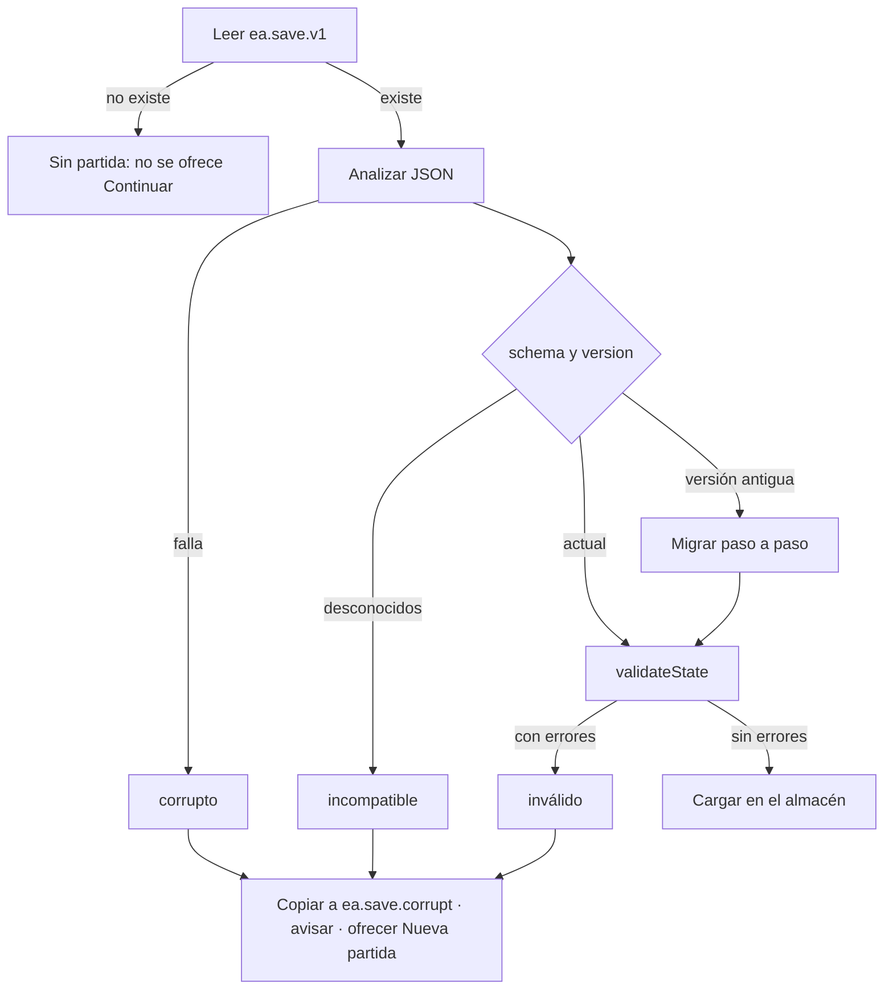

# Persistencia

## 1. Identificación y límites

| Campo | Valor |
| --- | --- |
| ID | C-27 |
| Prioridad · fase | Opciones: P0 · H3. Guardado de campaña: P1 |
| Objetivo | Conservar las opciones siempre y, en P1, la campaña, sin que un dato roto impida jugar. |
| Responsabilidad | `src/app/options.ts`, `src/app/persistence.ts`, `src/core/save.ts`, `src/core/validate.ts` |
| Depende de | [ARQUITECTURA.md](../ARQUITECTURA.md) (`SaveData`, `GameState`), [arranque-y-escenas](arranque-y-escenas.md) (`Options`) |
| No incluye | Guardado en la nube ni cuentas. |
| Responsable · revisor | A · C |
| Estado | Propuesto |

## 2. Arquitectura y funcionamiento

Todo se guarda en `localStorage`. **Opciones y partida van en claves distintas**, así cambiar idioma, audio o accesibilidad nunca toca la partida.

| Clave | Contenido | Fase |
| --- | --- | --- |
| `ea.options.v1` | `Options` | P0 |
| `ea.learning.v1` | Contadores agregados de la comprobación de aprendizaje | P0 |
| `ea.save.v1` | `SaveData`: instantánea de campaña | P1 |
| `ea.save.corrupt` | Copia del último guardado ilegible, para diagnóstico | P1 |

### Opciones

Al arrancar: leer → validar campo a campo → sustituir cada valor inválido por su valor por defecto → usar. Al cambiar: escribir y emitir `options/changed`. Si `localStorage` no está disponible, las opciones viven en memoria y el juego funciona igual.

### Instantánea de campaña (P1)

`SaveData = { schema: 'earths-angel/save', version, savedAtDay, state }`. El estado incluye dificultad, nivel, mapa, edificios, inventario, tripulación, día local, plazo global, objetivos, programa de eventos, semilla, pistas, estado narrativo y transiciones aplicadas con su bono.

**Puntos estables de guardado:**

1. Al crear la misión.
2. Al abrir cada día, con la fase en `planning` o `decision`.
3. Después de cada `applyTransition`, antes de la cinemática.
4. Al terminar una misión.

Nunca se guarda a mitad de `advanceDay`.

### Carga



**Una partida cargada valida los mismos invariantes que una nueva.** `createCampaign` y `deserialize` terminan las dos en `validateState`.

### Invariantes de `validateState`

1. Versión, dificultad y nivel conocidos.
2. Dimensiones del mapa iguales a las del nivel; número de casillas = ancho × alto; una sola nave.
3. Cada edificio: tipo disponible en el nivel, casilla explorada, terreno correcto, posición única.
4. Cada recurso: entero entre 0 y su capacidad.
5. Tripulación: tamaño de la dificultad, salud de 0 a 100, exposición ≥ 0.
6. `day >= 1`, `earthDaysRemaining >= 0`.
7. Programa de eventos: tipos conocidos y `sourceRef` presente en el extracto NASA.
8. Fase coherente: `ended` si y solo si hay resultado; `decision` si y solo si `decisionPending` tiene valor.
9. Puntos de acción entre 0 y el tamaño de la tripulación.
10. Transiciones coherentes con el nivel: estar en Marte exige `luna->marte` aplicada.
11. `collected` solo en casillas minerales. Racha entre 0 y el día actual.

### Migración

Tabla `migrations[version]`: función pura que lleva un estado de la versión `n` a la `n + 1`. Se aplican en cadena. Una versión mayor que la actual es incompatible.

## 3. Datos y uso

### Continuar, Reiniciar misión y Nueva partida

| Acción | Dónde | Efecto | Confirmación |
| --- | --- | --- | --- |
| Continuar | Título, si hay guardado válido | Carga la instantánea | No |
| Reiniciar misión | Pausa y resultado | Misma dificultad y semilla; plazo terrestre del inicio de esa misión | Sí |
| Nueva partida | Título | Crea campaña. Sobrescribe el guardado | Sí, si existe guardado |

En P0 no hay Continuar. Recargar la página vuelve al título. Reiniciar misión y Nueva partida funcionan igual.

### Casos límite

- Almacenamiento lleno o bloqueado: aviso discreto "No se pudo guardar" y el juego sigue.
- Dos pestañas abiertas: gana la última que guarda. No se sincronizan.
- Guardado de una versión del juego con otro balance: los invariantes lo detectan si ya no es válido.
- Recarga durante una cinemática de transición: la transición ya estaba guardada; se entra directo a la misión siguiente.

### Privacidad

No se guarda ningún dato personal. `ea.learning.v1` solo contiene recuentos.

## 4. Implementación delegable

**Tareas:** [T-P0-A5](../agentes/tareas/T-P0-A5-flujo-y-opciones.md) (opciones), [T-P0-A4](../agentes/tareas/T-P0-A4-nucleo-tripulacion-y-objetivos.md) (`validateState`), T-P1-A2 en [P1](../agentes/tareas/P1-campana-principal.md) (campaña).

**Prompt breve:**

```text
Implementa src/app/options.ts con validación campo a campo y la clave ea.options.v1, y
src/core/validate.ts con los once invariantes de docs/componentes/persistencia.md.
Un valor roto en localStorage nunca debe impedir el arranque.
```

**Pruebas:** U-OPC-01 a U-OPC-04, U-VAL-01 a U-VAL-04; en P1, U-GUA-01 a U-GUA-06 en [PRUEBAS.md](../PRUEBAS.md).

**Criterios de aceptación:** las opciones sobreviven a una recarga; texto basura en la clave no rompe el arranque; `validateState` detecta un recurso negativo, un edificio sobre roca y una fase incoherente.

**Evidencia:** pruebas en verde.

**Terminado cuando:** C confirma que las opciones persisten en los tres navegadores.

**Riesgos:** guardar un estado a medio turno. Mitigación: solo se guarda en los cuatro puntos estables.
