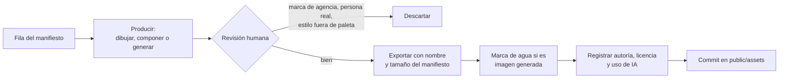

# Proceso de activos

## 1. Identificación y límites

| Campo | Valor |
| --- | --- |
| ID | C-29 |
| Prioridad · fase | P0, continuo |
| Objetivo | Que cada imagen y sonido llegue al juego con el nombre correcto, el tamaño correcto y su autoría y licencia registradas. |
| Responsabilidad | `public/assets/**`, manifiesto de [ARTE-Y-ACTIVOS.md](../ARTE-Y-ACTIVOS.md), sección de C en [IA-Y-CREDITOS.md](../IA-Y-CREDITOS.md) |
| Depende de | [NASA-SPACE-APPS-2026.md](../NASA-SPACE-APPS-2026.md) (IA, datos y derechos) |
| No incluye | Código de carga (mapa, interfaz y audio cargan sus propios activos). |
| Responsable · revisor | C · B |
| Estado | Exportación reproducible y metadatos PNG. La presentación local omite rótulos del arte. |

## 2. Arquitectura y funcionamiento

### De la idea al juego



### Reglas de entrada

1. **El manifiesto manda.** Un archivo se carga por su ruta exacta. Otro nombre u otro tamaño no entra.
2. **Tres orígenes permitidos:** hecho por el equipo, generado con IA y revisado por el equipo, o de terceros de libre disposición sin restricciones o con licencia OSI. Lo demás no se usa.
3. **Nada con marca ajena:** ni logotipos, insignias, banderas o identificadores de misión de NASA o de otra agencia, ni personas reales.
4. **Registro antes del commit.** Un activo sin fila de autoría y licencia no se fusiona.

### Identificación para la entrega de Space Apps

Estas condiciones se aplican al material que se presenta al evento. El build local mantiene los créditos y metadatos.

| Tipo | Cómo se identifica |
| --- | --- |
| Ilustraciones, viñetas, fondo, logotipo | Marca de agua visible "AI-generated" dentro de la imagen, legible al tamaño en que se muestra |
| Sprites de 24 píxeles e iconos | La procedencia figura en créditos y comentarios de los PNG. Las hojas de sprites y capturas que se presenten al evento necesitan identificación visible. |
| Video de demostración | Marca visible si contiene imagen generada |
| Audio | Texto de créditos y metadatos del archivo: comentario "AI-generated with <herramienta>" |
| Código y datos | Texto de créditos y comentario en la primera línea del archivo |

## 3. Datos y uso

### Carpetas

| Carpeta | Contenido | Formato |
| --- | --- | --- |
| `public/assets/sprites/` | Terreno, edificios, tripulación, objetos | PNG con transparencia |
| `public/assets/ui/` | Iconos, logotipo, fondo del menú | PNG |
| `public/assets/cinematics/` | Viñetas | PNG de 640 × 360 |
| `public/assets/fonts/` | Tipografías y su licencia | WOFF2 + `LICENSE.txt` |
| `public/assets/audio/music/`, `sfx/` | Música y efectos | OGG |

### Exportación

- Pixel art sin suavizado. Los atlas se muestran a 2× en el escenario base y el escenario se ajusta a la ventana. [Exportadores y tamaños](../ARTE-Y-ACTIVOS.md#uso-y-exportación).
- Paleta de [ARTE-Y-ACTIVOS.md](../ARTE-Y-ACTIVOS.md). Luz desde arriba a la izquierda.
- Nombres en minúsculas con guiones: `building-panel.png`.
- Peso orientativo: sprites de menos de 10 KB, viñetas de menos de 300 KB, música de menos de 1,5 MB por pista.

### Prompts de producción

Los prompts base y por activo están en [ARTE-Y-ACTIVOS.md](../ARTE-Y-ACTIVOS.md#prompts-de-producción). Cada resultado aceptado se anota con el prompt exacto que lo produjo.

### Recuperación

Todo cargador tiene respaldo: el mapa dibuja rectángulos con letras, la interfaz muestra texto en lugar de icono, las cinemáticas muestran paneles de color y el audio usa el sintetizador. Un activo ausente nunca detiene el juego.

### Casos límite

- La herramienta genera algo parecido a un logotipo real: se descarta, no se retoca para taparlo.
- Activo de terceros con licencia que exige atribución o impone condiciones: se consulta antes de usarlo; la opción segura es no usarlo.
- Tipografía sin tildes o sin ñ: no sirve para el español.

## 4. Implementación delegable

**Tarea:** [T-P0-C5](../agentes/tareas/T-P0-C5-arte.md) y [T-P0-C6](../agentes/tareas/T-P0-C6-audio.md).

**Prompt breve:**

```text
Produce los activos P0 del manifiesto de docs/ARTE-Y-ACTIVOS.md siguiendo
docs/componentes/proceso-de-activos.md: nombre y tamaño exactos, paleta del proyecto, marca de
agua en ilustraciones generadas y una entrada en docs/IA-Y-CREDITOS.md por cada activo.
```

**Pruebas:** M-ART-01 a M-ART-03 en [PRUEBAS.md](../PRUEBAS.md).

**Criterios de aceptación:** cada archivo de `public/assets` tiene fila en el manifiesto con autoría y licencia; toda ilustración generada lleva marca de agua; ningún activo contiene marca de agencia.

**Evidencia:** hoja de sprites y manifiesto actualizado.

**Terminado cuando:** B revisó los activos en el juego y C actualizó créditos.

**Riesgos:** activos sin registrar por las prisas. Mitigación: el revisor no fusiona un activo sin su fila.
